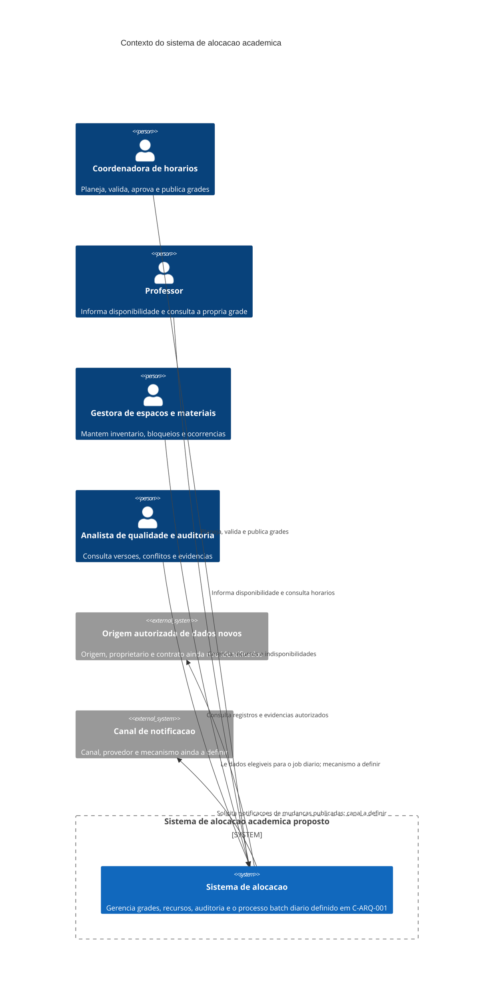
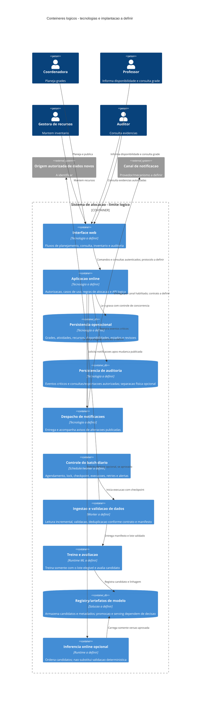
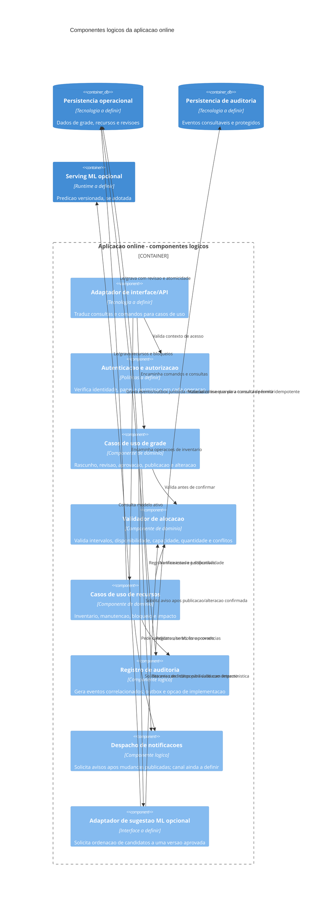
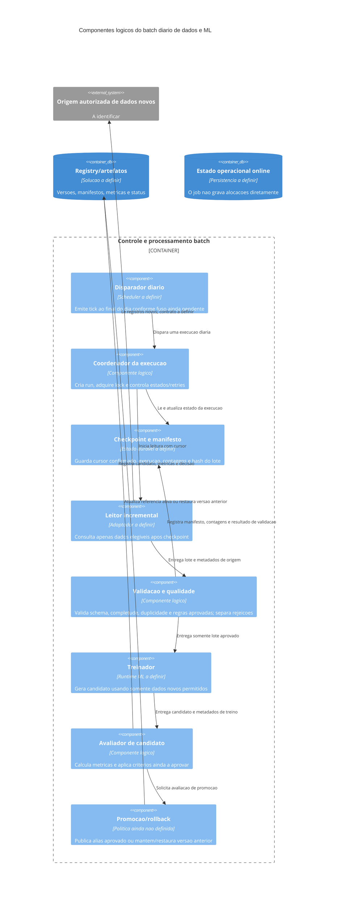
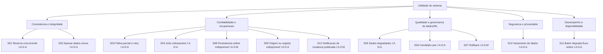

# Arquitetura de Software

> **Status:** seção inicial, baseada nos artefatos disponíveis e sujeita à validação. Este documento não registra decisões de tecnologia nem altera RF ou RNF.

## 1. Contexto e objetivo

### Fatos documentados

- O produto proposto deve apoiar a alocação acadêmica de salas, professores e materiais sem conflitos de horário. Essa intenção está descrita nos quatro documentos de personas e em [PRD/requisitos-funcionais.md](../PRD/requisitos-funcionais.md).
- O escopo do PRD inclui planejar, validar, aprovar, publicar e alterar grades, além de consultar recursos, disponibilidade e histórico. Ver os requisitos `RF-COORD-001` a `RF-COORD-020`, `RF-PROF-001` a `RF-PROF-020`, `RF-REC-001` a `RF-REC-020` e `RF-AUD-001` a `RF-AUD-020` em [PRD/requisitos-funcionais.md](../PRD/requisitos-funcionais.md).
- As personas são declaradamente fictícias e suas hipóteses ainda precisam ser validadas: [PRD/persona-01-coordenadora-de-horarios.md](../PRD/persona-01-coordenadora-de-horarios.md), [PRD/persona-02-professor.md](../PRD/persona-02-professor.md), [PRD/persona-03-gestora-de-espacos-e-materiais.md](../PRD/persona-03-gestora-de-espacos-e-materiais.md) e [PRD/persona-04-analista-de-qualidade-e-auditoria.md](../PRD/persona-04-analista-de-qualidade-e-auditoria.md).
- O [README.md](../README.md) descreve o estado atual do repositório como uma aplicação educacional Java 17/Spring Boot 3.2.0, com MongoDB, Thymeleaf e Bootstrap, voltada a cadastros de alunos e professores. Isso é contexto da aplicação existente, não uma decisão documentada de arquitetura para o produto de alocação proposto.
- O [CHANGELOG.md](../CHANGELOG.md) registra uma correção histórica de configuração do `MockMvc` em teste MVC. Não registra decisão de arquitetura para alocação de recursos.
- O [PRD/requisitos-nao-funcionais.md](../PRD/requisitos-nao-funcionais.md) apresenta metas e perfis de carga como propostas iniciais a validar, não como compromissos aprovados.k

### Objetivo arquitetural

Estabelecer uma base rastreável para decisões futuras do sistema de alocação, destacando as propriedades que condicionam sua arquitetura: consistência das alocações, proteção dos dados, auditabilidade, desempenho, disponibilidade e a rotina mandatória de treinamento diário descrita na seção de restrições. A arquitetura concreta, tecnologias e topologia permanecem em aberto até que as lacunas deste documento sejam respondidas.

### Restrições de entrada

- **C-ARQ-001 - Treinamento diário com dados novos:** existe um cron job executado diariamente ao final do dia para treinar ou retreinar usando somente dados novos. Esta restrição foi informada na solicitação que originou este documento; não foi localizada nos artefatos do repositório. O identificador `C-ARQ-001` é local a este documento e não substitui nem altera um RF/RNF do PRD. A interpretação de “final do dia” e “dados novos”, entre outros detalhes, continua pendente.

## 2. Stakeholders e personas

Os documentos identificam quatro perfis de usuário. Como declaram que são fictícios, eles são referências de descoberta e não evidência de entrevistas ou de stakeholders reais identificados.

| Persona | Interesse arquitetural | Fonte |
| --- | --- | --- |
| Ana Paula Ribeiro, coordenadora de horários | Elaborar, validar, comparar, submeter e publicar grades; evitar conflitos e preservar histórico. | [PRD/persona-01-coordenadora-de-horarios.md](../PRD/persona-01-coordenadora-de-horarios.md); `RF-COORD-009` a `RF-COORD-020` |
| Marcos Vinícius Lima, professor | Informar disponibilidade, consultar a grade vigente e receber mudanças com privacidade. | [PRD/persona-02-professor.md](../PRD/persona-02-professor.md); `RF-PROF-002` a `RF-PROF-020` |
| Renata Costa Nascimento, gestora de espaços e materiais | Manter recursos, bloqueios e ocorrências consistentes e compreender impactos nas alocações. | [PRD/persona-03-gestora-de-espacos-e-materiais.md](../PRD/persona-03-gestora-de-espacos-e-materiais.md); `RF-REC-001` a `RF-REC-020` |
| Diego Ferreira Alves, analista de qualidade e auditoria | Consultar versões, conflitos, histórico, permissões e relatórios sem alterar os dados auditados. | [PRD/persona-04-analista-de-qualidade-e-auditoria.md](../PRD/persona-04-analista-de-qualidade-e-auditoria.md); `RF-AUD-001` a `RF-AUD-020` |

**Stakeholders ainda não identificados nos artefatos:** direção/aprovadores reais, responsáveis por infraestrutura e operação, responsáveis por segurança e privacidade, proprietários dos dados usados no treinamento e avaliadores com autoridade para aceitar metas de qualidade.

## 3. Requisitos arquiteturalmente significativos

1. **Integridade temporal e ausência de conflitos:** validar professor, sala e materiais ao salvar; considerar sobreposições, recorrência e buffers configurados. Origem: `RF-COORD-009` a `RF-COORD-012`, `RF-REC-014` a `RF-REC-016`; qualidade relacionada: `RNF-GER-012` a `RNF-GER-014`, `RNF-REC-003`.
2. **Alocação de recursos com capacidades e estado:** validar compatibilidade de salas e quantidades disponíveis de materiais; impedir o uso de recursos inativos ou bloqueados. Origem: `RF-COORD-006` a `RF-COORD-008`, `RF-REC-003` a `RF-REC-006`, `RF-REC-014` e `RF-REC-015`.
3. **Concorrência e versionamento de grades:** impedir sobrescrita silenciosa e conservar rascunhos e versões; comparar alterações e controlar aprovação/publicação. Origem: `RF-COORD-016` a `RF-COORD-020`; qualidade relacionada: `RNF-COORD-004` a `RNF-COORD-006`.
4. **Controle de acesso e privacidade:** restringir consultas e alterações por papel e proteger disponibilidades pessoais, relatórios e exportações. Origem: `RF-PROF-020`, `RF-AUD-001`, `RF-AUD-018` e `RF-AUD-019`; qualidade relacionada: `RNF-GER-003` a `RNF-GER-006`, `RNF-PROF-005`, `RNF-AUD-003` e `RNF-AUD-007`.
5. **Auditoria e rastreabilidade:** relacionar ações a agente, horário, objeto, estado anterior/novo, resultado e justificativa quando aplicável; tornar eventos consultáveis. Origem: `RF-COORD-018` a `RF-COORD-020`, `RF-REC-013`, `RF-REC-020`, `RF-AUD-007` a `RF-AUD-015` e `RF-AUD-019`; qualidade relacionada: `RNF-GER-007` a `RNF-GER-010`, `RNF-REC-006` e `RNF-AUD-005` a `RNF-AUD-008`.
6. **Publicação e comunicação de mudanças:** separar proposta de grade oficial, identificar versão e vigência e notificar pessoas afetadas. Origem: `RF-COORD-016` a `RF-COORD-020`, `RF-PROF-007` a `RF-PROF-016`, `RF-REC-012` e `RF-REC-019`; qualidade relacionada: `RNF-COORD-010`, `RNF-PROF-004`, `RNF-PROF-007` e `RNF-PROF-009`.
7. **Execução diária de treinamento com dados novos:** cumprir `C-ARQ-001`. Fonte: solicitação atual do usuário, não um artefato PRD. Dados elegíveis, definição de novidade, resultado esperado, retenção, falhas e operação não estão especificados.
8. **Desempenho, disponibilidade e recuperação mensuráveis:** atender às metas propostas apenas depois de validá-las com carga e infraestrutura representativas. Origem: `RNF-GER-011` a `RNF-GER-016`, `RNF-COORD-001`, `RNF-COORD-006`, `RNF-PROF-002`, `RNF-REC-001` e `RNF-AUD-001`/`RNF-AUD-009`.
9. **Acessibilidade e uso em dispositivos diversos:** garantir fluxos críticos por teclado e leitor de tela e interfaces móveis conforme critérios documentados. Origem: `RNF-GER-017` a `RNF-GER-019`, `RNF-COORD-007`, `RNF-PROF-001`/`RNF-PROF-006` e `RNF-REC-007`/`RNF-REC-008`.

## 4. Atributos de qualidade

Os valores abaixo são os critérios propostos no PRD, ainda sujeitos à validação. Não são SLAs aprovados.

| Atributo | Critério documentado | Origem e ressalva |
| --- | --- | --- |
| Segurança e privacidade | TLS 1.2 ou superior; autorização no servidor; proteção de dados; não registrar segredos; controle de acesso a eventos e exportações. | `RNF-GER-001` a `RNF-GER-006`, `RNF-GER-008`, `RNF-PROF-005`, `RNF-AUD-003`/`RNF-AUD-007`/`RNF-AUD-010`. Política institucional e ambiente de implantação ainda não especificados. |
| Consistência e concorrência | Para 100 tentativas simultâneas de reserva do mesmo recurso exclusivo e intervalo, no máximo uma alocação incompatível pode ser confirmada; sem gravação parcial. | `RNF-GER-013`/`RNF-GER-014`, `RNF-REC-003`; cenário proposto, exige definição de ambiente e método de teste. |
| Desempenho | Perfil inicial: 25 usuários simultâneos, 1.000 atividades, 100 professores, 50 salas, 200 registros de materiais, 10 minutos após 2 minutos de aquecimento; medições repetidas pelo menos três vezes. Consultas comuns: p95 até 2 s e p99 até 5 s; validação: p95 até 3 s e p99 até 5 s. | `PRD/requisitos-nao-funcionais.md`, perfil de carga e `RNF-GER-011`/`RNF-GER-012`. O documento marca esses valores como iniciais e sujeitos a validação. |
| Disponibilidade e recuperação | Meta inicial mensal de 99,5%; RPO até 15 min; RTO até 4 h. | `RNF-GER-015`/`RNF-GER-016`; metas propostas, não validadas com operação ou custos. |
| Auditabilidade e rastreabilidade | 100% das operações críticas com evento de auditoria; eventos protegidos contra alteração por usuários comuns; horário UTC, correlação e retenção configurada. | `RNF-GER-007` a `RNF-GER-010`, `RNF-AUD-005`/`RNF-AUD-006`. Definição institucional de retenção pendente. |
| Usabilidade e acessibilidade | Fluxos críticos conforme WCAG 2.2 AA; critérios de teste com 4 de 5 participantes em tarefas específicas. | `RNF-GER-017`, `RNF-COORD-003`/`RNF-COORD-009`, `RNF-PROF-007`/`RNF-PROF-010`, `RNF-REC-009`. Personas são hipóteses, então participantes e roteiros ainda precisam ser definidos. |
| Compatibilidade | Fluxos críticos nas duas versões estáveis mais recentes de Chrome, Firefox, Edge e Safari. | `RNF-GER-019`; matriz de ambientes precisa ser confirmada conforme navegadores realmente suportados pela instituição. |
| Observabilidade | Logs estruturados, duração, resultado e identificador de correlação, sem segredos ou dados pessoais desnecessários. | `RNF-GER-006`, `RNF-GER-009` e `RNF-GER-020`; política de acesso e retenção ainda pendente. |
| Operação de treinamento | Execução diária ao final do dia usando somente dados novos. | `C-ARQ-001`, informado pelo usuário nesta solicitação. Sem RNF correspondente nos arquivos consultados; condições de sucesso e falha ainda não especificadas. |

## 5. Drivers priorizados

Prioridade abaixo é **análise arquitetural preliminar**, não prioridade atribuída por stakeholders nos documentos. `P0` indica condição bloqueadora para uma arquitetura válida; `P1`, influência forte; `P2`, importante e a detalhar. A ordem deve ser confirmada com os stakeholders reais.

| Prioridade | Driver | Razão arquitetural | Origem rastreável |
| --- | --- | --- | --- |
| P0 | Não confirmar alocações incompatíveis sob concorrência. | Uma dupla reserva invalida a finalidade principal do produto e pode comprometer o horário publicado. | `RF-COORD-009` a `RF-COORD-012`, `RF-REC-014` a `RF-REC-016`, `RNF-GER-013`/`RNF-GER-014`, `RNF-REC-003`. |
| P0 | Restringir acesso e proteger dados pessoais e segredos. | Disponibilidades e dados de auditoria exigem autorização; os RNFs exigem proteção em trânsito, em repouso e nos logs. | `RF-PROF-020`, `RF-AUD-001`, `RF-AUD-018`/`RF-AUD-019`, `RNF-GER-001` a `RNF-GER-006`. |
| P0 | Cumprir o job diário de treinamento usando apenas dados novos. | Restrição operacional mandatória informada nesta solicitação; muda processamento, dados e observabilidade, embora detalhes ainda não estejam definidos. | `C-ARQ-001` (solicitação atual; não localizado em PRD/README/CHANGELOG). |
| P1 | Preservar versões, aprovação, publicação e histórico auditável. | Mudanças precisam ser revisáveis e atribuíveis; uma publicação oficial não pode ser confundida com rascunho. | `RF-COORD-016` a `RF-COORD-020`, `RF-AUD-002`, `RF-AUD-009` a `RF-AUD-013`, `RNF-GER-007` a `RNF-GER-010`. |
| P1 | Atender metas mensuráveis de latência sob carga documentada. | Consultas, validação, comparação, inventário e auditoria têm limites propostos, mas cargas diferentes. | `RNF-GER-011`/`RNF-GER-012`, `RNF-COORD-001`/`RNF-COORD-006`, `RNF-PROF-002`, `RNF-REC-001`, `RNF-AUD-001`/`RNF-AUD-009`. |
| P1 | Recuperar de falhas sem perda ou estado parcial. | Rascunhos, inventário e reservas precisam permanecer consistentes; existem metas iniciais de RPO/RTO. | `RF-COORD-017`, `RNF-COORD-004`/`RNF-COORD-005`, `RNF-REC-010`, `RNF-GER-014` a `RNF-GER-016`. |
| P2 | Garantir acessibilidade, usabilidade e suporte móvel. | Existem fluxos para usuários com contextos e dispositivos diferentes, com critérios de avaliação explícitos. | Personas em `PRD/persona-01-coordenadora-de-horarios.md`, `PRD/persona-02-professor.md`, `PRD/persona-03-gestora-de-espacos-e-materiais.md`; `RNF-GER-017`, `RNF-COORD-007`/`RNF-COORD-009`, `RNF-PROF-001`/`RNF-PROF-006`, `RNF-REC-007`/`RNF-REC-009`. |
| P2 | Sustentar exportações e evidências reproduzíveis de auditoria. | Avaliação depende de relatórios rastreáveis, íntegros e sem exposição indevida. | `RF-AUD-016`/`RF-AUD-017`, `RNF-AUD-002` a `RNF-AUD-010`. |

## 6. Glossário

| Termo | Significado neste documento | Origem ou estado |
| --- | --- | --- |
| Alocação | Associação de uma atividade a um intervalo e aos recursos necessários, como professor, sala e materiais. | Derivado de `RF-COORD-003` a `RF-COORD-009`. |
| Conflito | Sobreposição ou incompatibilidade que torna impossível reservar o mesmo recurso, ou excede quantidade/capacidade configurada. | `RF-COORD-009` a `RF-COORD-012`, `RF-REC-014`/`RF-REC-015`; regras detalhadas ainda incompletas. |
| Disponibilidade | Intervalo no qual pessoa ou recurso pode ser utilizado conforme cadastro e estado. | `RF-COORD-005`, `RF-PROF-002`/`RF-PROF-003`, `RF-REC-006`. |
| Restrição obrigatória | Indisponibilidade que não pode ser tratada como preferência negociável. | `RF-PROF-004`; política de precedência ainda não definida. |
| Preferência negociável | Horário desejado que pode não ser atendido se as demais regras assim exigirem. | `RF-PROF-004`; método de priorização não definido. |
| Rascunho / publicada | Estados distintos de uma grade; apenas uma versão aprovada pode ser publicada. | `RF-COORD-016` a `RF-COORD-020`. |
| Dados novos | Dados elegíveis para o job diário conforme `C-ARQ-001`. | Definição operacional ausente; não assumir que significa apenas registros criados desde a última execução. |
| Job/cron diário | Processo agendado diariamente ao final do dia para treinar ou retreinar. | `C-ARQ-001`; fuso, janela, gatilhos e tratamento de falhas pendentes. |
| p95 / p99 | Percentis de latência: 95% ou 99% das medições ficam no limite ou abaixo dele. | Métricas referenciadas em `RNF-GER-011`/`RNF-GER-012` e outros RNFs. |
| RPO | Perda máxima de dados, expressa como intervalo de tempo, aceitável após incidente. | Meta inicial em `RNF-GER-016`; ainda não validada. |
| RTO | Tempo-alvo para recuperação do serviço após incidente. | Meta inicial em `RNF-GER-016`; ainda não validada. |
| RNF / RF | Requisito não funcional / requisito funcional. | Convenção dos documentos `PRD/requisitos-nao-funcionais.md` e `PRD/requisitos-funcionais.md`. |

## 7. Riscos iniciais

| ID | Risco | Evidência/origem | Impacto potencial e lacuna |
| --- | --- | --- | --- |
| R-ARQ-001 | Escopo atual do repositório diverge do produto descrito no PRD. | `README.md` descreve cadastro de alunos/professores; RF descrevem alocação acadêmica. | Pode haver lacuna entre aplicação existente e arquitetura necessária. Não há decisão documentada sobre extensão, substituição ou coexistência. |
| R-ARQ-002 | Regras de negócio essenciais para conflito e exceção estão incompletas. | `RF-COORD-010` a `RF-COORD-013`, `RF-REC-014` a `RF-REC-016`; hipóteses da persona 01. | Comportamentos diferentes em fronteiras de intervalo, recorrência, buffers, preferências e exceções podem gerar grades incorretas. Regras oficiais não foram encontradas. |
| R-ARQ-003 | A rotina de treinamento diário não tem contrato operacional definido. | `C-ARQ-001` vem da solicitação atual; não há RF/RNF sobre treinamento nos arquivos PRD. | Não é possível decidir dados, isolamento, janela, idempotência, avaliação, falha, retentativa ou publicação do resultado sem respostas adicionais. |
| R-ARQ-004 | “Somente dados novos” pode ter interpretações incompatíveis. | Formulação de `C-ARQ-001`. | O treinamento pode omitir histórico necessário ou reprocessar dados; falta definir novidade, duplicidade, watermark e política após falha. Nenhum algoritmo é pressuposto. |
| R-ARQ-005 | Metas de qualidade são propostas e cargas não estão unificadas. | Nota do PRD RNF; perfil inicial e `RNF-GER-011` a `RNF-GER-016`, além de metas específicas. | Aprovação prematura pode criar metas irrealistas ou testes incomparáveis. O perfil menciona 25 usuários/1.000 atividades, enquanto `RNF-REC-001` e `RNF-AUD-001` usam 10.000 recursos e 100.000 eventos. |
| R-ARQ-006 | Critérios de latência podem ter interpretação sobreposta. | `RNF-GER-011` estabelece p95 de consulta comum até 2 s; `RNF-COORD-001` estabelece abertura da grade até 3 s. | Não está definido se abrir a grade é uma consulta comum ou uma exceção específica. Resolver antes de critérios de aceite. |
| R-ARQ-007 | Política de dados, retenção e privacidade não foi identificada. | `RNF-GER-005`, `RNF-GER-010`, `RNF-AUD-010`; hipóteses da persona 04. | Não se conhece base legal, classificação, prazo, descarte nem permissão para dados usados no treinamento ou homologação. |
| R-ARQ-008 | O README contém URI de conexão MongoDB com credencial aparente. | `README.md`, seção “Conexão ao Banco de Dados”. | A credencial deve ser tratada como potencialmente exposta e avaliada para rotação/remediação. Este documento não replica o valor nem altera o README. |
| R-ARQ-009 | Decisões anteriores de arquitetura não estão registradas. | `CHANGELOG.md` registra uma correção de teste MVC, não ADRs; não foram encontrados arquivos de regras ou decisões. | Decisões passadas podem existir fora do repositório e causar retrabalho se não forem recuperadas. |
| R-ARQ-010 | As personas não foram validadas e stakeholders reais permanecem desconhecidos. | Declarações de contexto nos quatro arquivos de persona. | Priorização e critérios de usabilidade podem não refletir usuários, políticas e operação reais. |

## 8. Fatos, lacunas, tensões e suposições

### Fatos documentados

- O PRD define um produto proposto para alocação de recursos acadêmicos sem conflitos e apresenta 80 RF em [PRD/requisitos-funcionais.md](../PRD/requisitos-funcionais.md).
- O PRD de RNF contém 20 requisitos gerais e 10 por persona; ele próprio classifica suas metas como propostas iniciais: [PRD/requisitos-nao-funcionais.md](../PRD/requisitos-nao-funcionais.md).
- As quatro personas declaram ser fictícias e pedem validação com pessoas reais.
- O README documenta a aplicação atual e sua stack; não declara que a solução de alocação está implementada.
- A restrição de job diário foi fornecida nesta solicitação e está registrada como `C-ARQ-001`.

### Lacunas documentais

- Não foi localizado documento dedicado a regras de negócio, exceções institucionais, política de aprovação, restrições de horário ou precedência entre restrições.
- Não foram localizados ADRs, decisões de arquitetura ou restrições de implantação além do README e do changelog consultados.
- O README e o changelog são os outros documentos Markdown encontrados na raiz; não foram encontrados arquivos `.txt`, `.adoc`, `.rst`, `.pdf`, `.docx`, `.yaml` ou `.yml`.
- Não estão especificados modelo, origem, formato, classificação ou critério de novidade dos dados de treinamento.
- Não estão identificados usuários, mantenedores, aprovadores, operadores, infraestrutura-alvo ou responsáveis por segurança/privacidade reais.
- Não há definição aprovada de volume, carga, disponibilidade, recuperação, retenção ou navegadores suportados; os valores do RNF estão marcados como propostas.

### Conflitos e tensões a resolver

- **Escopo:** aplicação atual descrita como CRUD de alunos/professores versus produto alvo de alocação de horários. Isso é uma diferença de escopo documentada, não prova de incompatibilidade técnica.
- **Desempenho:** `RNF-GER-011` limita consultas comuns a p95 de 2 s, enquanto `RNF-COORD-001` permite até 3 s para abrir a grade. Definir qual critério prevalece ou se a grade é exceção.
- **Perfis de carga:** o perfil geral e os testes de recursos/auditoria indicam volumes diferentes (`RNF-REC-001`, `RNF-AUD-001`). Eles podem ser cenários distintos, mas faltam perfis e relações explicitamente definidos.
- **Treinamento:** `C-ARQ-001` requer apenas dados novos, mas o PRD não define processamento de dados nem como o resultado do treinamento pode afetar alocações. Não assumir influência sobre a grade ou publicação automática.

### Suposições analíticas provisórias

- A priorização `P0/P1/P2` deste documento é uma classificação arquitetural preliminar com base no impacto aparente dos requisitos, não uma prioridade aprovada por usuários ou direção.
- O perfil de carga descrito no RNF pode ser usado para um ensaio inicial, mas não representa capacidade ou volume de produção confirmado.
- O sistema em foco é o produto futuro descrito nos artefatos PRD; a relação de implementação com a aplicação CRUD atual permanece em aberto.
- `C-ARQ-001` significa literalmente executar diariamente ao final do dia e usar somente dados novos; não se presume timezone, mecanismo de scheduler, algoritmo, conjunto de dados ou política de retreinamento.

## 9. Perguntas abertas

1. O produto de alocação será evolução da aplicação CRUD descrita no README, substituição ou sistema separado?
2. Quem são os stakeholders reais que aprovam prioridades, regras, metas de qualidade e exceções?
3. Quais são as regras oficiais para intervalos adjacentes, recorrência, feriados, fusos horários, buffers, deslocamento, capacidade e recursos fungíveis?
4. Quem pode autorizar exceções e quais justificativas são obrigatórias?
5. O que é “final do dia” para `C-ARQ-001`: qual fuso horário, horário de corte e comportamento em feriados ou indisponibilidade?
6. O que conta como “dado novo”: criação desde a execução anterior, alteração, dado ainda não processado ou outra regra? Como identificar duplicatas e atrasos?
7. Qual é a fonte, o esquema, a classificação, o consentimento/base de uso e o período de retenção dos dados de treinamento?
8. Qual é o resultado esperado do treinamento/retreinamento? Como validar, versionar, aceitar ou reverter esse resultado? O job pode afetar dados ou alocações em produção?
9. O que deve ocorrer se o job falhar, não houver dados novos, houver dados inválidos ou a execução anterior ainda estiver em andamento?
10. Quais alarmes, responsável de plantão, política de retentativa e evidências de execução são necessários para o job?
11. Quais perfis de carga são aceitos para consulta, geração/validação da grade, inventário, auditoria e treinamento?
12. Para abertura da grade, prevalece `RNF-GER-011` (p95 até 2 s) ou `RNF-COORD-001` (p95 até 3 s)?
13. As metas propostas de disponibilidade, RPO, RTO e latência foram aceitas pelos responsáveis de negócio e infraestrutura?
14. Qual é a política institucional de retenção, exclusão, anonimização e acesso aos registros de auditoria e dados pessoais?
15. A credencial aparente na URI do README continua ativa? Qual processo autorizado será usado para rotação e remoção segura?

## 10. Fontes consultadas

- [PRD/persona-01-coordenadora-de-horarios.md](../PRD/persona-01-coordenadora-de-horarios.md)
- [PRD/persona-02-professor.md](../PRD/persona-02-professor.md)
- [PRD/persona-03-gestora-de-espacos-e-materiais.md](../PRD/persona-03-gestora-de-espacos-e-materiais.md)
- [PRD/persona-04-analista-de-qualidade-e-auditoria.md](../PRD/persona-04-analista-de-qualidade-e-auditoria.md)
- [PRD/requisitos-funcionais.md](../PRD/requisitos-funcionais.md)
- [PRD/requisitos-nao-funcionais.md](../PRD/requisitos-nao-funcionais.md)
- [README.md](../README.md)
- [CHANGELOG.md](../CHANGELOG.md)

## 11. Responsabilidades, limites e interfaces

### Limites arquiteturais propostos

Os limites abaixo são **responsabilidades lógicas**, não decisões de implantação, processos independentes ou tecnologias. O PRD não define monólito, microsserviços, banco de dados novo, plataforma de ML, protocolo de integração ou infraestrutura.

| Limite lógico | Responsabilidades | Não deve assumir |
| --- | --- | --- |
| Interface de usuário | Apresentar grade, recursos, estados, conflitos, resultados de solicitações e feedback; iniciar consultas e comandos em nome do usuário. | Não é autoridade para validar permissões ou conflitos; validação exclusivamente no cliente não atende `RNF-GER-003` e `RF-COORD-009`. |
| Aplicação online de alocação | Autenticar/autorizar operações; executar casos de uso de grade e inventário; validar restrições e conflitos; preservar versão; coordenar persistência e registrar auditoria. | Não delega a um modelo a decisão final de validade de uma alocação. Não executa treinamento pesado no caminho síncrono do usuário. Esta separação de execução é uma proposta para proteger latências, não um requisito explícito de implantação. |
| Domínio de alocação | Definir e aplicar invariantes de período, intervalos, recursos, capacidade, quantidade, estado, recorrência e compatibilidade, conforme regras que ainda precisam ser aprovadas. | Não inventa regras para lacunas como limites adjacentes, prioridades ou exceções; essas regras precisam de fonte institucional. |
| Persistência operacional | Preservar atividades, recursos, disponibilidade, alocações, estados, versões e solicitações com consistência suficiente para impedir dupla reserva. | Tecnologia, modelo de dados, transações e topologia física permanecem indefinidos. |
| Auditoria | Registrar eventos críticos e disponibilizar consulta/exportação autorizada com vínculo a usuário, ação, objeto e resultado. | Não oferece edição de eventos ao perfil auditor; não deve incluir segredos ou dados pessoais desnecessários. |
| Ingestão batch | Ler apenas o delta elegível segundo o checkpoint confirmado; validar, deduplicar conforme uma chave aprovada, produzir manifesto e isolar registros rejeitados. | Não define por conta própria a fonte, a chave de identidade, o schema ou a política de elegibilidade. |
| Orquestração batch | Disparar a execução diária, controlar estado, lock, checkpoint, retry, retomada, alertas e histórico do job. | Não pode considerar o disparo do scheduler prova de que a execução terminou com sucesso. |
| Treinamento e avaliação | Usar o conjunto permitido da execução para produzir e avaliar um candidato reprodutível; registrar métricas e linhagem. | Algoritmo, alvo, features, limiares, tamanho mínimo de dados e significado de “retreinar” não estão definidos. |
| Registry e serving de modelo | Caso o modelo seja usado online, armazenar artefatos/metadados versionados, expor somente versões aprovadas e permitir apontar/retornar à versão ativa. | O PRD não exige registry, serving, promoção automática nem que o modelo participe da alocação; são propostas de arquitetura para tornar o ciclo controlável. |

### Limite de confiança e autoridade

- A aplicação online é a autoridade para identidade, autorização, invariantes de negócio e confirmação de alocações (`RNF-GER-003`, `RF-COORD-009` a `RF-COORD-012`).
- A ingestão batch só pode ler a fonte aprovada e o intervalo de dados elegível; não pode escrever diretamente em alocações ou publicar uma grade.
- Um eventual modelo pode sugerir ou ordenar candidatos para `RF-COORD-015`, mas cada sugestão precisa passar novamente pela validação determinística da aplicação. A sugestão não pode reservar recurso nem publicar grade.
- Treinamento, avaliação, registro, promoção e uso online de modelo são etapas distintas. Um artefato recém-treinado não se torna automaticamente o modelo em produção.
- Dados de operação, checkpoints, eventos de auditoria e artefatos de modelo têm propósitos e permissões diferentes. Compartilhamento físico entre eles é uma escolha de implantação ainda aberta, não uma autorização para compartilhamento lógico.

### Interfaces lógicas

Os contratos a seguir são propostas de fronteira. Não estabelecem caminhos HTTP, protocolo, formatos serializados, nomes de tabelas ou tecnologia.

| Interface lógica | Consumidor -> provedor | Contrato mínimo proposto | Justificativa/rastreabilidade |
| --- | --- | --- | --- |
| Consulta de agenda/recursos | Interface -> aplicação online | Critérios de período, turma, professor, sala ou recurso; resposta com versão/estado e dados autorizados; erro distinguível de vazio. | `RF-COORD-008`, `RF-PROF-009` a `RF-PROF-012`, `RF-REC-007` a `RF-REC-009`; `RNF-GER-011`. |
| Comando de alocação/grade | Interface -> aplicação online | Atividade e intervalo, recorrência configurada, recursos requeridos, ator autenticado e revisão esperada; resultado aceito ou conflito explicado com recursos/intervalos. | `RF-COORD-004` a `RF-COORD-014`, `RF-COORD-017`; `RNF-GER-013`/`RNF-GER-014`. |
| Disponibilidade | Interface -> aplicação online | Identidade do professor obtida do contexto autenticado; intervalos, validade e tipo de restrição/preferência; confirmação somente após persistência. | `RF-PROF-002` a `RF-PROF-006`, `RF-PROF-020`; `RNF-PROF-003`/`RNF-PROF-008`. |
| Auditoria e exportação | Perfil autorizado -> aplicação online | Filtros, período e formato permitido; resultado com versão, solicitante e momento de geração; autorização aplicada também à exportação. | `RF-AUD-008` a `RF-AUD-020`; `RNF-AUD-001` a `RNF-AUD-004`. |
| Evento de auditoria | Casos de uso online -> armazenamento/serviço de auditoria | Ator, instante UTC, ação, objeto, estado anterior/novo quando aplicável, resultado, justificativa e correlação; persistência correlacionada ao comando crítico. | `RNF-GER-007` a `RNF-GER-009`; `RF-AUD-007`, `RF-AUD-009` a `RF-AUD-012`. Outbox transacional é alternativa de implementação, não requisito. |
| Fonte de dados novos | Ingestão batch -> origem autorizada (a identificar) | Leitura incremental por cursor, janela ou manifesto; schema/versionamento e identificador estável precisam ser acordados; leitura deve ser repetível. | `C-ARQ-001`; a fonte e o contrato não aparecem no PRD. |
| Checkpoint/execução | Orquestrador e ingestão -> estado durável do batch | Identificador da execução, cursor confirmado por origem/partição, estado da execução, manifesto, tentativas e versão do pipeline; transições auditáveis. | Necessário para satisfazer “somente dados novos” em `C-ARQ-001`; estratégia é proposta sem requisito operacional detalhado. |
| Ingestão -> treino/avaliação | Ingestão -> worker de treinamento | Referência imutável do lote novo validado, manifesto/checksum, schema, contagens, recusas e versão da transformação. | `C-ARQ-001`; `RNF-AUD-004`/`RNF-AUD-009` sustentam reprodutibilidade/evidência, mas não definem contrato ML. |
| Treinamento -> registry | Worker -> registry lógico | Artefato candidato e metadados: run ID, código/configuração, manifesto de dados, transformações, seed quando aplicável, métricas e resultado de validação. | `RNF-AUD-004`, `RNF-AUD-008`/`RNF-AUD-009`; registry não é exigido explicitamente. |
| Serving opcional | Aplicação online -> inferência de modelo aprovado | Entrada mínima necessária, identificador imutável da versão, candidatos/ordenação e resultado; timeout/indisponibilidade não pode desabilitar a validação de conflitos. | `RF-COORD-015` permite propostas automáticas, mas não exige ML; `RNF-GER-011`/`RNF-GER-012` motivam isolamento temporal. |

## 12. Diagramas C4

Os diagramas mostram limites lógicos e tecnologias não selecionadas. Os elementos “fonte de dados novos”, “registry” e “serving” representam fronteiras necessárias ou alternativas para a restrição batch, não serviços existentes ou fornecedores escolhidos. As relações são conceituais; protocolo e formato permanecem abertos.

### 12.1 Contexto



### 12.2 Contêineres lógicos



> O desenho não determina que cada contêiner seja um processo ou serviço separado. Uma implantação inicial pode agrupar responsabilidades, desde que preserve os limites de autorização, consistência e falha.

### 12.3 Componentes online



### 12.4 Componentes batch e ML



> O registry e os dados online são limites distintos; o modelo pode ser lido pelo serving, mas o job não escreve alocações. A ligação operacional de serving ao alias ativo está no diagrama de contêineres. Não há requisito que autorize publicação automática de uma grade pelo batch.

## 13. Decisões de desenho propostas e alternativas

Nenhum item desta seção é uma ADR aprovada. As escolhas indicadas como **proposta** são recomendações reversíveis para discussão; as demais permanecem em aberto.

| Tema | Proposta ou alternativas | Base e status |
| --- | --- | --- |
| Separação online/batch | **Proposta:** separar recursos e ciclo de vida do processamento online transacional e do worker diário. Alternativas: mesmo processo/deploy com filas internas; deploys separados; plataforma batch gerenciada. | A separação protege latência e disponibilidade online (`RNF-GER-011`/`015`) e isola treino do caminho de alocação. Não há requisito explícito de topologia: escolha de deployment sem requisito direto. |
| Modelo no fluxo online | **Proposta:** primeiro entregar alocação determinística; habilitar ML apenas como ranking opcional para `RF-COORD-015`. Alternativas: não integrar modelo ao online; usar modelo apenas offline para gerar sugestões revisadas; usar ranking online atrás de timeout/fallback. | RF pede proposta automática, mas não especifica ML. Escolher ou exigir serving é decisão sem requisito explícito. Validação determinística é motivada por `RF-COORD-009` e `RNF-GER-013`. |
| Persistência/consistência | Escolher o mecanismo que permita confirmação atômica ou estratégia equivalente para alocação e controle de concorrência. Alternativas de implementação incluem transação serializável/constraint, lock de domínio ou compare-and-swap com revisão; a adequação depende da persistência selecionada. | `RNF-GER-013`/`014`, `RNF-COORD-005`; tecnologia e isolamento não definidos. |
| Checkpoint de dados novos | **Alternativas:** cursor/offset monotônico da origem; watermark por timestamp de evento com janela de atraso e deduplicação; manifesto imutável de lote diário. Usar cursor somente se origem garantir ordenação/continuidade; watermark de evento somente se fonte, atrasos e identidade forem conhecidos. | `C-ARQ-001` requer somente dados novos. Não há origem ou semântica de ordenação definida. Seleção pendente; decisão sem requisito adicional. |
| Lock do job | **Proposta condicional:** se houver múltiplas réplicas, lock durável com lease, heartbeat, expiração e fencing token; em processo único, lock local não protege contra execução em outro nó. Alternativas: lock no banco, lease distribuído ou scheduler que assegure exclusão mútua. | Evita execuções simultâneas e checkpoints concorrentes, necessário para operacionalizar `C-ARQ-001`; mecanismo específico sem requisito de infraestrutura. |
| Validação e promoção do modelo | **Proposta:** candidato só se torna ativo após validação e política de aprovação registrada; manter a versão ativa anterior disponível para rollback. Alternativas: promoção manual; automática após limiares e testes; nenhum uso online. | Reprodutibilidade e auditabilidade (`RNF-AUD-004`, `RNF-AUD-008`/`009`) e segurança operacional. Aprovação de modelo, métrica e limiar não têm requisito explícito; escolha pendente. |
| Persistência de eventos | Outbox transacional ou gravação sincronizada correlacionada; fila/event bus apenas se houver necessidade/infraestrutura aprovada. | Cobertura auditável (`RNF-GER-007`/`008`) e consistência (`RNF-GER-014`). Outbox é alternativa de implementação, não tecnologia decidida. |
| Dados de treino e artefatos | **Proposta:** separar logicamente dados brutos restritos, dados validados/manifestos e artefatos de modelo; separação física depende de risco e operação. Alternativas: armazenamento governado existente ou camada dedicada. | Minimização/privacidade (`RNF-GER-002`/`005`), segredo em logs (`RNF-GER-006`), evidência reprodutível (`RNF-AUD-004`). Local e formato não definidos. |

## 14. Fluxo batch diário: watermark, execução e recuperação

### 14.1 Contrato de execução

O cron deve disparar diariamente ao final do dia, conforme `C-ARQ-001`. O horário local, timezone, janela, feriados, fonte, volume e duração máxima não estão definidos. O desenho abaixo é uma proposta operacional e não altera a restrição.

1. O disparador cria ou recupera uma execução com `run_id` e referência ao agendamento lógico do dia; o timezone só pode ser configurado após decisão.
2. O coordenador adquire exclusão mútua antes de ler ou atualizar checkpoint. Execução concorrente deve aguardar, falhar de modo seguro ou se tornar no-op, conforme política a aprovar.
3. O leitor captura o checkpoint confirmado e solicita à origem somente o intervalo posterior a esse ponto. A consulta e seu resultado são registrados em manifesto imutável.
4. A validação verifica formato/schema, campos obrigatórios, consistência temporal, duplicatas, completude e critérios de elegibilidade que o proprietário dos dados vier a aprovar. Registros recusados são isolados com motivo e não entram no treino.
5. O lote elegível é materializado de forma repetível e identificado por origem, intervalo/cursor, schema, transformações e hash/manifesto. Nenhum registro anterior ao checkpoint é incluído como dado de treino.
6. O treinador usa apenas os dados novos aceitos do manifesto. Se uma validação exige holdout, a proposta é reservar parte do mesmo lote novo para validação; quantidade mínima, divisão e métricas são perguntas abertas.
7. O avaliador registra métricas e resultado. Se os dados forem insuficientes, inválidos ou o candidato não cumprir critérios aprovados, não há promoção; o último modelo ativo, se existir, permanece inalterado.
8. O artefato e o resultado são registrados de forma idempotente. A promoção, quando aprovada, atualiza uma referência/version pointer de forma controlada; rollback aponta para a última versão previamente aprovada.
9. O checkpoint só avança quando o lote tem resultado durável e rastreável (por exemplo, candidato registrado, rejeição registrada ou resultado sem dados). Uma aprovação manual pendente é estado de modelo, não motivo para reprocessar o mesmo lote diariamente.
10. Lock é liberado; run final, contagens, watermark anterior/novo, resultado e alertas ficam registrados sem conteúdo pessoal desnecessário.

### 14.2 Watermark/checkpoint

“Somente dados novos” exige um critério de novidade durável. Não há no repositório garantia de timestamp confiável, cursor monotônico, chave única nem comportamento da origem para eventos atrasados.

| Alternativa | Adequada quando | Risco/condição | Status |
| --- | --- | --- | --- |
| Offset/ID monotônico confirmado pela origem | A origem expõe sequência sem lacunas ou cursor consistente por partição. | Inserções tardias com offset antigo e mudanças em registros existentes podem ficar de fora; precisa de contrato da fonte. | Alternativa candidata, não selecionada. |
| Watermark de tempo de evento | A origem possui timestamp de evento confiável e semântica de atraso conhecida. | Dados atrasados exigem janela de sobreposição; reler dados requer deduplicação e idempotência. | Alternativa candidata, não selecionada. |
| Manifesto de exportação/snapshot | A origem publica lotes imutáveis identificados. | Depende de contrato de lote e de detectar lote incompleto. | Alternativa candidata, não selecionada. |

**Proposta independente da tecnologia:** guardar por origem/partição o último cursor confirmado, o estado do run, o manifesto do lote, contagens e resultado. Calcular `run_id` determinístico a partir da referência de execução e do manifesto/cursor para tornar repetição reconhecível. Se a origem não fornecer identificador estável, esta proposta não pode ser finalizada sem definir identidade/deduplicação.

**Regra de commit sugerida:** não avançar checkpoint antes de persistir resultado terminal do lote. Se processamento for repetido, reusar o mesmo manifesto e resultado, sem criar novo artefato equivalente nem duplicar efeitos. Uma falha depois do registro do artefato mas antes do checkpoint exige reconciliação por `run_id` antes de iniciar novo treinamento.

### 14.3 Idempotência, lock e concorrência

- Chave idempotente recomendada: origem + partição/intervalo + manifesto dos dados novos + versão de transformação/pipeline. A composição final depende do contrato da fonte.
- Gravações de manifesto, métrica, artefato e estado do run devem ser condicionadas ao mesmo `run_id`; repetição retorna/continua o mesmo run.
- O lock deve cobrir a leitura/commit do checkpoint, não apenas o disparo. Lease sem fencing pode permitir que um worker antigo continue após expiração; fencing token ou mecanismo equivalente é necessário se houver múltiplas réplicas.
- Alternativas de exclusão: singleton operacional, lock no banco, lease compartilhado ou scheduler com exclusão garantida. Sem topologia conhecida, não há decisão final.
- O job batch não disputa lock de alocação online nem escreve grades; as transações online continuam com suas próprias garantias (`RNF-GER-013`/`014`).

### 14.4 Retry e recuperação

- Repetir apenas falhas transitórias de leitura, rede ou infraestrutura, com número máximo, backoff e jitter configuráveis. Valores concretos dependem do orçamento e da origem, portanto não são definidos aqui.
- Erros permanentes de schema, autorização, qualidade ou política não devem entrar em retry infinito; encerrar run como falha/quarentena, preservar checkpoint e alertar responsável.
- Retomar a partir do último estágio durável; antes de repetir treino, consultar `run_id`, manifesto e artefato existentes.
- Se o worker morrer com lease ativa, permitir recuperação após expiração e fencing; o worker antigo não pode efetuar commit depois de perder o lease.
- Se não houver dados novos, registrar execução `no-op` com cursor inalterado e sem treinar ou promover. O cron permanece diário; não processar dados antigos para preencher a execução.
- Reprocessamento manual requer motivo, identidade do operador, manifesto original e resultado distinto/versionado; não deve ampliar silenciosamente a janela para dados históricos.
- Após falha de promoção, manter a versão previamente ativa; não promover parcialmente. A forma transacional/atômica depende do registry.

## 15. Qualidade, linhagem e reprodutibilidade de dados/ML

### Qualidade de dados

Os controles abaixo são propostas a parametrizar com o proprietário dos dados; os artefatos atuais não definem schemas nem limites de qualidade.

- Verificar schema e versão, campos obrigatórios, tipos, intervalos válidos e coerência entre timestamps e timezone declarado.
- Medir volume recebido, registros válidos/recusados, duplicatas, atraso e cobertura de campos por execução.
- Isolar registros inválidos com código de motivo e acesso restrito; não os misturar no lote de treino.
- Validar se os dados novos contêm informação suficiente para o alvo de treino, ainda não definido. Sem suficiência, registrar `no-train` ou falha controlada e não promover.
- Não definir limpeza, imputação, exclusão ou “outlier” sem decisão documentada do domínio/proprietário dos dados.

### Linhagem e reprodutibilidade

Cada execução deve poder identificar, no mínimo, sem expor os valores pessoais do dataset:

- ID da execução, origem lógica, partição/cursor inicial e final, horário UTC, contagens e hash/ID do manifesto.
- Versão do schema, código/commit, dependências/runtime, configuração e transformações aplicadas.
- Estratégia de split, seed quando aplicável, parâmetros de treino, métricas, logs sanitizados e status de validação.
- ID e hash do artefato, versão anterior, decisão de promoção/recusa, aprovador quando houver e motivo do rollback.
- Identificadores de correlação entre scheduler, ingestão, treinamento, avaliação, registry e alertas.

Retenção dos dados brutos, manifestos, logs e modelos precisa respeitar política aprovada e minimização (`RNF-GER-005`/`RNF-GER-010`). Reprodutibilidade não justifica reter indefinidamente cópias de dados pessoais.

### Validação, registry, promoção e rollback

- **Validação:** definir previamente métrica, baseline, tolerância, conjunto de avaliação e volume mínimo. Tais definições não estão nos requisitos; nenhum limiar ou algoritmo é assumido.
- **Dados de avaliação:** proposta inicial é separar treino/validação apenas dentro dos dados novos elegíveis, evitando ler dados históricos para treino. Perguntar se a restrição “somente dados novos” também limita validação e comparação com baseline.
- **Candidato insuficiente:** sem dados suficientes ou critério aprovado, registrar resultado e não substituir versão ativa.
- **Registry:** proposta de armazenar artefato imutável e metadados ligados à linhagem, estados `candidate`, `approved`, `active`, `rejected` e `retired`. Estados são convenção proposta, não requisito nem produto selecionado.
- **Promoção:** alternativa A, aprovação manual por responsável; alternativa B, promoção automática se gates explicitamente definidos forem satisfeitos; alternativa C, não servir modelos no online. O PRD não decide qual usar.
- **Ativação:** se houver serving, selecionar artefato por referência versionada, nunca por sobrescrita do arquivo ativo sem histórico. Verificar disponibilidade e compatibilidade antes de alterar referência.
- **Rollback:** restaurar referência ao último artefato aprovado, sem reexecutar treino nem reescrever histórico; registrar operador, motivo e hora. Critérios e autoridade de rollback precisam ser definidos.
- **Separação de efeitos:** modelo não publica grades, altera alocações ou ignora validação. Qualquer sugestão de `RF-COORD-015` passa pela aplicação online e pelas regras determinísticas.

## 16. Observabilidade, segurança, LGPD e custos

### Observabilidade

Registrar métricas e eventos por `run_id`: disparos esperados/observados, lock adquirido/renovado/perdido, duração por estágio, watermark/cursor, contagens, atrasos, rejeições, tentativas, resultado, hash do artefato, versão ativa e resultado de promoção/rollback. Alertar para execução ausente/atrasada, falha, checkpoint parado, lock expirado, taxa anormal de rejeição, qualidade insuficiente e falha de promoção. Limiares, canal, destinatários e escalação não estão definidos.

Para serving opcional, observar versão carregada, latência, timeout, taxa de erro e fallback. Não registrar features ou payloads pessoais em claro por padrão. A política de detecção de drift, avaliação de degradação e resposta fica pendente de objetivo e métricas de modelo.

### Segurança e LGPD

- Tratar disponibilidades, identificadores de usuários e dados acadêmicos potencialmente relacionados a pessoas como dados pessoais até classificação formal (`RF-PROF-020`, `RNF-GER-005`). Isso é precaução de projeto, não conclusão jurídica sobre base legal.
- Antes do treino, documentar finalidade, base legal/consentimento quando aplicável, controlador/operador, origem, minimização, retenção, compartilhamento e direitos dos titulares. A aplicabilidade concreta da LGPD e o papel institucional exigem validação jurídica/DPO.
- Aplicar menor privilégio e segregação de funções entre operador do job, proprietário dos dados, auditor e promotor do modelo (`RNF-GER-003`, `RNF-AUD-003`, `RNF-AUD-007`). Não permitir que o job use credenciais administrativas de usuário.
- Proteger dados e artefatos em trânsito e repouso (`RNF-GER-001`/`002`); gerenciar segredos fora do código e nunca expô-los em logs (`RNF-GER-006`, `RNF-GER-020`).
- Minimizar ou pseudonimizar dados identificáveis para treino e evidências, se a finalidade e qualidade permitirem; documentar limitações e risco de reidentificação. Pseudonimização não equivale a anonimização.
- Restringir acesso a manifestos, conjuntos temporários, checkpoints, candidatos e modelos; definir descarte/expiração alinhada à política (`RNF-GER-010`).
- Avaliar retenção de informações pessoais ou memorização no modelo, risco de inferência e impacto de correção/exclusão de dados. Não há exigência ou estratégia técnica documentada para machine unlearning; se requerida, precisa de análise própria.
- Segregar ambientes e proibir uso de produção em testes sem autorização, minimização ou anonimização adequada (`RNF-GER-005`, `RNF-AUD-010`).

### Custos

Não há orçamento, limite de custo, provedor ou volume real documentado; portanto não atribuo valores monetários nem escolho serviço.

- Medir custo por execução e por unidade de dados processada, duração/recursos de treino, armazenamento de lotes e artefatos, consultas de registry e inferência.
- Manter a execução cronológica diária, mas retornar `no-op` sem custo de treino quando não houver dados novos (`C-ARQ-001`); confirmar que essa interpretação atende ao responsável da restrição.
- Definir cotas/limites de duração e recursos, tamanho máximo de lote e política para run preso somente após conhecer fonte, runtime e orçamento.
- Expirar dados intermediários e versões não promovidas segundo política de retenção aprovada; preservar metadados de auditoria exigidos sem retenção indiscriminada de payloads.
- Comparar alternativas de treino sob demanda, runtime compartilhado ou ambiente separado quando volume e perfil de modelo forem conhecidos. Separação física pode aumentar isolamento e custo; não há evidência para quantificar o trade-off.

## 17. Sequências online e batch

### 17.1 Fluxo online de alocação

O modelo, se adotado, só produz sugestões. O fluxo determinístico é obrigatório para confirmar o comando conforme `RF-COORD-009` e `RNF-GER-013`; serving e timeout são alternativas arquiteturais, não requisitos já definidos.

```mermaid
sequenceDiagram
	autonumber
	actor C as Coordenadora
	participant UI as Interface
	participant API as Aplicacao online
	participant AUTH as Autorizacao
	participant RULES as Validador deterministico
	participant ML as Serving opcional
	participant DB as Persistencia operacional
	participant OUTBOX as Outbox de auditoria
	participant AUD as Auditoria
	participant NOTIFY as Despacho de notificacoes

	C->>UI: Solicita candidatos ou envia alocacao
	UI->>API: Comando + contexto autenticado + revisao esperada
	API->>AUTH: Verificar permissao para periodo e operacao
	AUTH-->>API: Permitido ou negado
	alt Sem permissao
		API->>AUD: Registrar tentativa negada sem incluir payload sensivel
		API-->>UI: Negado sem revelar dados protegidos
	else Permitido
		opt Pedido de sugestao automatica e ML habilitado
			API->>ML: Solicitar ranking de candidatos permitidos
			ML-->>API: Candidatos + versao do modelo
		end
		API->>RULES: Validar candidato/solicitacao contra estado atual
		RULES->>DB: Ler disponibilidade, recursos e revisao atual
		DB-->>RULES: Estado atual
		RULES-->>API: Valido ou conflito explicado
		alt Conflito ou revisao desatualizada
			API->>AUD: Registrar rejeicao/conflito e correlacao
			API-->>UI: Conflito, recurso e intervalo; sem gravacao
		else Valido
			API->>OUTBOX: Incluir evento no commit logico da mutacao
			OUTBOX->>DB: Confirmar alocacao + evento/outbox com revisao atomica
			DB-->>OUTBOX: Confirmado ou concorrencia detectada
			OUTBOX-->>API: Resultado da transacao
			opt Evento persistido para entrega assincrona
				OUTBOX->>AUD: Materializar evento idempotentemente para consulta
			end
			opt Comando publica ou altera grade publicada
				API->>NOTIFY: Solicitar notificacao apos confirmacao da publicacao
				NOTIFY-->>API: Aceita, pendente ou falha rastreada
			end
			API-->>UI: Resultado, nova revisao e identificador
		end
	end
```

**Contrato de falha proposto:** indisponibilidade do ML não impede consulta ou alocação manual; a aplicação pode retornar sem ranking ou usar alternativa sem ML. Indisponibilidade da persistência/autorização não pode ser tratada como alocação confirmada. Timeout/fallback de ML é decisão sem limite específico no PRD; sua duração deve caber no orçamento do fluxo e nos `RNF-GER-011`/`RNF-GER-012`.

### 17.2 Fluxo batch diário de treinamento

O diagrama explicita que checkpoint e modelo ativo são estados distintos. A execução consome um delta; só o resultado do modelo aprovado altera o ponteiro ativo. Estados e aprovação são propostas, pois nenhum requisito determina promoção automática.

```mermaid
sequenceDiagram
	autonumber
	participant CRON as Disparador diario
	participant ORCH as Coordenador batch
	participant LOCK as Lock/lease
	participant CKPT as Checkpoint e manifesto
	participant SRC as Origem de dados a identificar
	participant DQ as Validacao de dados
	participant TRAIN as Treinador
	participant EVAL as Avaliador
	participant REG as Registry de modelos
	participant OPS as Operacao/alertas

	CRON->>ORCH: Tick diario ao final do dia
	ORCH->>LOCK: Adquirir lock com identidade da execucao
	alt Lock indisponivel
		LOCK-->>ORCH: Outra execucao ativa
		ORCH->>OPS: Registrar skip/concorrencia e alertar conforme politica
	else Lock adquirido
		LOCK-->>ORCH: Lease + fencing token
		ORCH->>CKPT: Ler cursor confirmado e estado do run
		CKPT-->>ORCH: Checkpoint anterior
		ORCH->>SRC: Ler somente dados depois do cursor
		alt Nenhum dado novo
			SRC-->>ORCH: Delta vazio
			ORCH->>CKPT: Registrar no-op; manter cursor
			ORCH->>OPS: Registrar sucesso sem treino
		else Dados encontrados
			SRC-->>ORCH: Delta + referencias de origem
			ORCH->>DQ: Validar schema, elegibilidade e duplicatas
			DQ-->>ORCH: Lote valido + rejeicoes + manifesto
			alt Lote invalido ou insuficiente
				ORCH->>CKPT: Registrar falha/quarentena; nao avancar cursor
				ORCH->>OPS: Emitir alerta e evidencias sanitizadas
			else Lote novo elegivel
				ORCH->>TRAIN: Treinar apenas com dados novos do manifesto
				TRAIN-->>EVAL: Candidato + configuracao + linhagem
				EVAL->>EVAL: Validar com criterios aprovados e dados permitidos
				alt Candidato rejeitado ou avaliacao inconclusiva
					EVAL-->>ORCH: Rejeitado/inconclusivo
					ORCH->>REG: Registrar candidato e resultado sem ativar
					ORCH->>CKPT: Registrar resultado duravel e avancar cursor
					ORCH->>OPS: Alertar/registrar resultado
				else Candidato aprovado
					EVAL-->>ORCH: Aprovado segundo politica configurada
					ORCH->>REG: Registrar artefato versionado e metadados
					opt Promocao aprovada pela politica
						ORCH->>REG: Ativar versao por referencia atomica
						alt Referencia ativa confirmada
							REG-->>ORCH: Versao ativa confirmada
						else Falha ao atualizar referencia
							REG-->>ORCH: Promocao nao confirmada; manter versao anterior
							ORCH->>OPS: Alertar e agendar reconciliacao da promocao sem novo treino
						end
					end
					ORCH->>CKPT: Registrar candidato/resultado duravel e avancar cursor segundo politica aprovada
					ORCH->>OPS: Registrar metricas, versao e status
				end
			end
		end
		ORCH->>LOCK: Liberar lease
	end
```

> Se persistir o artefato e falhar a atualização do checkpoint, a retomada deve procurar a execução pelo mesmo manifesto/run ID e reconciliar o estado antes de treinar novamente. Se ativação do modelo e checkpoint não forem transacionais entre si, registrar a ordem e uma rotina de reconciliação; não considerar uma promoção confirmada até o registry confirmar a referência ativa.

## 18. Decisões ainda não tomadas

Os itens abaixo não devem ser tratados como arquitetura aprovada até que os responsáveis sejam identificados e as perguntas de `C-ARQ-001` sejam respondidas.

- Se o modelo terá função online; `RF-COORD-015` pede proposta automática, mas não especifica ML.
- Fonte, schema, owner, identidade e semântica de “dados novos”, cursor, atraso e correção de registros.
- Fuso horário e instante exato para “final do dia”, janela batch e execução em feriados.
- Modelo, objetivo, features, métricas, baseline, split, volume mínimo e critério para rejeitar/publicar.
- Se a promoção será manual, automática ou não existirá; autoridade e política de rollback.
- Tecnologia e topologia de scheduler, lock, storage, registry, serving, observabilidade e secrets.
- Necessidade de fila/event bus e se auditoria deve usar outbox ou outra garantia equivalente.
- Classificação legal/institucional de dados, base de tratamento, retenção, exclusão e uso em treinamento.
- Limites de custo, quotas e capacidade do batch/serving.

As respostas devem ser registradas como decisões rastreáveis, com contexto, alternativas, consequências, responsável e requisitos relacionados. Nenhuma delas deve ser introduzida como alteração aos RF/RNF sem atualização aprovada da fonte de verdade.

## 19. Avaliação ATAM independente

### 19.1 Escopo e método

Esta avaliação usa somente as quatro personas, [PRD/requisitos-funcionais.md](../PRD/requisitos-funcionais.md), [PRD/requisitos-nao-funcionais.md](../PRD/requisitos-nao-funcionais.md) e as propostas já registradas neste documento. A rotina diária de treinamento continua sendo `C-ARQ-001`, informada pelo usuário e não pelo PRD.

Os perfis, valores de carga, metas de latência, disponibilidade, recuperação e usabilidade do RNF são **hipóteses pendentes de aprovação**. Esta avaliação não os transforma em métricas acordadas, não acrescenta limites numéricos e não considera as abordagens propostas como decisões aprovadas. Métricas sem limite existente são descritas como observáveis a coletar; o limiar fica explicitamente aberto.

### 19.2 Drivers e atributos priorizados

A prioridade reflete impacto arquitetural inferido a partir das fontes, não uma prioridade negociada com stakeholders reais. As personas são fictícias. `P0` é bloqueador para a validade da solução; `P1` é alto impacto; `P2` depende de validação/escopo. Dificuldade de realização/validação: `A` alta, `M` média, `B` baixa; é julgamento ATAM qualitativo, não uma estimativa de esforço.

| Prioridade | Driver/atributo | Por que é prioritário | Origem rastreável | Dificuldade inicial |
| --- | --- | --- | --- | --- |
| P0 | Consistência e integridade da alocação concorrente | Uma dupla reserva ou gravação parcial compromete a finalidade central do sistema. | `RF-COORD-009` a `RF-COORD-012`; `RF-REC-014` a `RF-REC-016`; `RNF-GER-013`/`RNF-GER-014`; `RNF-REC-003`. | A |
| P0 | Correção do processamento incremental diário | A única restrição de ML é executar diariamente e usar somente dados novos; cursor errado pode repetir ou omitir dados silenciosamente. | `C-ARQ-001`; análise de watermark e checkpoint em §14.2. | A |
| P0 | Segurança, privacidade e não vazamento | Disponibilidade, dados acadêmicos e rastros de operação exigem acesso controlado e proteção de dados. | `RF-PROF-020`; `RNF-GER-001` a `RNF-GER-008`; `RNF-AUD-003`/`RNF-AUD-010`. | A |
| P1 | Recuperação segura de execução parcial e de jobs sobrepostos | Retry sem idempotência/lock confiável pode duplicar efeitos ou avançar checkpoint sem resultado durável. | `C-ARQ-001`; `RNF-GER-014`; abordagens propostas em §14.3/§14.4. | A |
| P1 | Auditabilidade e reprodutibilidade do ciclo ML | Sem linhagem, não se reconstrói quais dados/transformações produziram um candidato nem por que foi promovido. | `RF-AUD-008` a `RF-AUD-012`; `RNF-GER-007` a `RNF-GER-010`; `RNF-AUD-004`/`RNF-AUD-008`/`RNF-AUD-009`. | M/A |
| P1 | Qualidade do modelo e controle de promoção/rollback | O PRD não define tarefa, métricas nem gates; promover candidato inferior pode prejudicar sugestões. | `RF-COORD-015` permite proposta automática, mas não exige ML; abordagem proposta em §15. | A |
| P1 | Disponibilidade e desempenho do plano online durante batch/falhas | Treino, armazenamento ou serving opcionais não devem invalidar a consulta ou a validação transacional da grade. | `RNF-GER-011`/`RNF-GER-012`/`RNF-GER-015`; `RF-COORD-009`; separação proposta em §13. | M/A |
| P2 | Usabilidade, acessibilidade e compatibilidade | Necessário para os fluxos das quatro personas, mas os perfis e testes são hipóteses a validar. | `RNF-GER-017` a `RNF-GER-019`; RNFs específicos por persona. | M |
| P2 | Custo e governança operacional | O treino diário, armazenamento de snapshots e serving podem adicionar custo e obrigações de retenção. | §16; não existem orçamento, fonte, volume real ou limite aprovados. | M/A |

### 19.3 Utility tree

As folhas indicam cenários avaliados nesta seção. Cada folha mostra `I` (importância) e `D` (dificuldade) qualitativas. Importância alta e dificuldade alta sinalizam cenário de risco arquitetural que merece validação antecipada, não um score numérico.



**Atributos prioritários:** consistência, integridade transacional, segurança/privacidade, confiabilidade/recuperação, auditabilidade e reprodutibilidade. Desempenho e disponibilidade são também prioritários, mas seus números permanecem provisórios. Qualidade do modelo, promoção e uso online não são requisitos aprovados; entram como riscos condicionais porque `C-ARQ-001` exige treinamento e `RF-COORD-015` admite proposta automática sem definir ML.

### 19.4 Cenários ATAM priorizados

Cada cenário segue a estrutura **fonte, estímulo, ambiente, artefato, resposta e métrica**. `I` e `D` são importância e dificuldade qualitativas, respectivamente. Nenhuma métrica numérica nova é proposta; quando o PRD não fornece limite, isso é indicado no campo métrica.

#### S01 - Tentativas concorrentes para o mesmo recurso

- **Fonte:** Coordenadora de horários e usuários concorrentes; `Persona 01`, `RF-COORD-009` a `RF-COORD-012`.
- **Estímulo:** Duas ou mais solicitações tentam confirmar alocações incompatíveis do mesmo recurso e intervalo.
- **Ambiente:** Execução online sob concorrência; volume e persistência são os do perfil de teste acordado. O RNF usa 100 tentativas simultâneas como cenário proposto, ainda pendente de aprovação.
- **Artefato:** Validador de alocação, controle de concorrência, persistência e evento de auditoria.
- **Resposta:** No máximo uma alocação incompatível é confirmada; as demais recebem conflito claro; nenhuma deixa gravação parcial.
- **Métrica:** Resultado de `RNF-GER-013`/`RNF-GER-014` e `RNF-REC-003`; valores são hipóteses do RNF, não metas aprovadas. **I:A, D:A.**

#### S02 - Execução diária usando apenas dados novos

- **Fonte:** Restrição `C-ARQ-001`, fornecida pelo usuário; responsável pela origem dos dados ainda não identificado.
- **Estímulo:** Chega o tick diário e a origem contém registros novos após o checkpoint confirmado.
- **Ambiente:** Execução batch normal com checkpoint legível, lock adquirido e dados disponíveis; fuso e corte diário pendentes.
- **Artefato:** Scheduler, leitor incremental, checkpoint, manifesto e conjunto entregue ao treinador.
- **Resposta:** O job registra origem e intervalo/cursor, gera manifesto reproduzível e entrega ao treino somente os dados novos elegíveis; não lê dados anteriores como exemplos de treino.
- **Métrica:** Comparar o manifesto e os IDs/cursor efetivamente consumidos com o checkpoint anterior; nenhuma entrada de treino pode precedê-lo. É critério derivado de `C-ARQ-001`, não um SLA numérico; sem contrato da fonte, a verificação não é finalizável. **I:A, D:A.**

#### S03 - Falha parcial durante ingestão, treino, registry ou checkpoint

- **Fonte:** Operação batch; `C-ARQ-001`, `RNF-GER-014`, requisitos de rastreabilidade `RNF-GER-007` a `RNF-GER-009`.
- **Estímulo:** Worker ou dependência falha após uma etapa ter persistido, inclusive depois de criar candidato e antes de atualizar checkpoint.
- **Ambiente:** Falha transitória ou reinício; o run pode ser retomado após perda do processo.
- **Artefato:** Estado do run, manifesto, artefato candidato, lock e checkpoint.
- **Resposta:** Retomar/reconciliar pelo mesmo ID idempotente; não duplicar artefato/efeito; não avançar checkpoint sem resultado durável; preservar o modelo ativo anterior até promoção confirmada.
- **Métrica:** Correspondência entre run ID, manifesto, artefatos e cursor antes/depois; ausência de avanço do checkpoint sem estado terminal persistido. O PRD não define tempo de recuperação batch nem política quantitativa de retries. **I:A, D:A.**

#### S04 - Dois jobs diários sobrepostos

- **Fonte:** Agendador/operador; requisito de frequência `C-ARQ-001`.
- **Estímulo:** Dois disparos ou workers iniciam o mesmo lote, por atraso do job anterior, retry ou duplicação do scheduler.
- **Ambiente:** Uma ou mais instâncias do processador; topologia não definida.
- **Artefato:** Coordenador, lease/lock, fencing token, execução idempotente e checkpoint.
- **Resposta:** Apenas um proprietário válido altera o estado do lote; o outro aguarda, termina em no-op ou falha de modo rastreável. Worker que perdeu lease não pode fazer commit tardio.
- **Métrica:** Estado de execução, titularidade/fencing e histórico do checkpoint demonstram ausência de commits concorrentes para o mesmo lote. Limite de espera/retry não existe no PRD. **I:A, D:A.**

#### S05 - Degradação, duplicação ou atraso dos dados novos

- **Fonte:** Origem e proprietário dos dados, ambos a identificar; `C-ARQ-001`, `RNF-GER-005` e hipóteses de dados em §15.
- **Estímulo:** O lote contém schema inesperado, campos ausentes, registros duplicados, timestamps atrasados ou qualidade inferior à esperada.
- **Ambiente:** Execução batch com dados de origem parcialmente válidos ou com atraso; regras de elegibilidade ainda não aprovadas.
- **Artefato:** Leitor, validador de qualidade, deduplicação, manifesto e conjunto de treino.
- **Resposta:** Classificar registros de forma rastreável; rejeitar ou colocar em quarentena o que não atende a regras aprovadas; impedir que dados inválidos sejam treinados; não descartar dados silenciosamente.
- **Métrica:** Contagens por classe (novo válido, duplicado, tardio, rejeitado), manifesto e prova de que apenas válidos chegam ao treinador. Limites de completude, atraso, nulidade e taxa de rejeição estão ausentes. **I:A, D:A.**

#### S06 - Candidato avaliado como pior que o modelo ativo

- **Fonte:** Avaliador do modelo e owner de negócio; `C-ARQ-001`, `RNF-AUD-004`, `RNF-AUD-008`/`RNF-AUD-009`; nenhum RF define qualidade do modelo.
- **Estímulo:** Um candidato treinado apenas com o lote novo não atende à métrica/gate de qualidade que vier a ser aprovada ou a avaliação é inconclusiva.
- **Ambiente:** Há um modelo ativo anterior, ou o serving está desabilitado; avaliação tem dados permitidos e critérios versionados.
- **Artefato:** Avaliador, registry, referência ativa e relatório de linhagem.
- **Resposta:** Registrar métricas e decisão; não promover candidato pior/inconclusivo; manter modelo ativo anterior ou, se não houver, manter sugestão por ML desabilitada. A regra exata depende de gate que ainda não existe.
- **Métrica:** Métrica de qualidade, baseline, tolerância e volume mínimo são perguntas abertas; a evidência disponível é status de aprovação/recusa e ponteiro ativo inalterado. Não criar um limiar antes da decisão de produto. **I:A, D:A.**

#### S07 - Rollback de versão promovida

- **Fonte:** Operador/model owner ainda não identificado; proposta em §15; evidência e auditoria `RNF-GER-007`/`RNF-AUD-004`.
- **Estímulo:** Uma versão ativa apresenta degradação ou defeito confirmado após promoção.
- **Ambiente:** Serving de ML habilitado e existe uma versão anterior aprovada disponível; cenário condicional, pois o PRD não exige serving.
- **Artefato:** Registry, alias/referência ativa, serving e trilha de auditoria.
- **Resposta:** Restaurar a referência anterior aprovada sem retreinar nem alterar alocações; registrar operador, motivo, versão removida e restaurada; se a versão antiga não existir, desabilitar sugestão ML e manter fluxo determinístico.
- **Métrica:** Versão ativa observada após operação, histórico íntegro e resultado do fluxo online. Tempo máximo de rollback não consta nos RNFs. **I:A, D:M.**

#### S08 - Persistência operacional online indisponível

- **Fonte:** Falha de infraestrutura; `RF-COORD-009`, `RNF-GER-014`, `RNF-COORD-004`.
- **Estímulo:** A aplicação não consegue ler ou gravar o estado operacional durante uma tentativa de alocação.
- **Ambiente:** Fluxo online em horário de planejamento; armazenamento indisponível ou timeout.
- **Artefato:** Aplicação online, validador e persistência operacional.
- **Resposta:** Não declarar a alocação confirmada, não produzir estado parcial, informar falha recuperável e preservar a última versão confirmada; o modelo não substitui a persistência.
- **Métrica:** Zero confirmações de sucesso sem persistência confirmada e nenhuma alteração parcial, critérios derivados de `RNF-GER-014`; disponibilidade de escrita/tempo de recuperação não está especificado para esse caso. **I:A, D:M.**

#### S09 - Origem batch, checkpoint ou registry indisponível

- **Fonte:** Dependência externa/operacional; `C-ARQ-001`, `RNF-GER-016` e `RNF-GER-020`.
- **Estímulo:** Durante o tick diário, leitura da origem ou registro do candidato/checkpoint falha.
- **Ambiente:** Job iniciado, dependência indisponível de forma transitória ou persistente.
- **Artefato:** Coordenador, origem, checkpoint, registry e alerta operacional.
- **Resposta:** Registrar estágio e causa sem expor dados; não avançar checkpoint se o lote não tiver resultado durável; repetir somente falhas transitórias segundo política aprovada; manter serving/versão ativa intactos. Se não for possível determinar o checkpoint, parar com segurança.
- **Métrica:** Estado e watermark não avançam sem confirmação durável; retries e alerta ficam auditáveis. Limites de retry e recuperação batch estão pendentes. **I:A, D:A.**

#### S10 - Exposição de dado pessoal, segredo ou feature sensível

- **Fonte:** Usuário sem permissão, operador, saída de erro ou artefato/log; `RF-PROF-020`, `RNF-GER-003` a `RNF-GER-006`, `RNF-AUD-003`/`RNF-AUD-010`.
- **Estímulo:** Consulta não autorizada ou inspeção de logs, manifesto, relatório, conjunto temporário ou modelo tenta revelar disponibilidade, identificação, credencial ou dado pessoal desnecessário.
- **Ambiente:** Online e batch; dados reais ou sintéticos conforme autorização; controles de acesso em vigor.
- **Artefato:** Autorização, interface de exportação, logs, storage temporário, checkpoints e artefatos ML.
- **Resposta:** Negar acesso; mascarar/minimizar o que não é necessário; não incluir payload sensível em logs; registrar tentativa sem replicar o segredo; permitir revisão de acesso/retention conforme política aprovada.
- **Métrica:** Testes negativos de autorização e varredura de logs/exportações sem exposição de valores sensíveis, conforme `RNF-GER-003`/`006` e `RNF-AUD-010`. A classificação dos dados e conjunto de testes ainda precisam ser definidos. **I:A, D:A.**

#### S11 - Batch/serving degrada desempenho do fluxo online

- **Fonte:** Coordenadora ou professor usando o sistema enquanto batch/serving consome recursos; `RNF-GER-011`/`RNF-GER-012`/`RNF-GER-015`, `RNF-COORD-001`, `RNF-PROF-002`; proposta de separação em §13.
- **Estímulo:** Job de treino ou inferência coincide com consultas, validações e gravações da grade.
- **Ambiente:** Perfil de carga inicial do RNF, ainda não aprovado; infraestrutura compartilhada ou separada é desconhecida.
- **Artefato:** Scheduler, worker de treino, aplicação online, persistência e serving opcional.
- **Resposta:** Online continua validando regras; batch não retém recurso crítico sem limite; se ML atrasa/falha, sugestões ficam indisponíveis/fallback e operações manuais determinísticas continuam. Se persistência online não atender, não confirmar gravações.
- **Métrica:** Medir p50/p95/p99 e taxa de erro online durante e sem batch, comparando com `RNF-GER-011`/`RNF-GER-012` e `RNF-COORD-001`; valores são hipóteses pendentes e há tensão entre p95 de consulta comum (2 s) e abertura da grade (3 s). **I:A, D:A.**

#### S12 - Notificação de alteração publicada

- **Fonte:** Coordenadora publica/edita grade; professor ou coordenação recebe a mudança; `RF-PROF-014`/`RF-PROF-015`, `RF-REC-019` e auditoria `RF-AUD-015`.
- **Estímulo:** Uma publicação confirmada altera atividade, sala ou disponibilidade de recurso que afeta usuários.
- **Ambiente:** Fluxo online com canal interno disponível ou provedor externo parcialmente indisponível; canal final ainda não foi escolhido.
- **Artefato:** Aplicação online, despacho de notificações, estado de entrega e auditoria.
- **Resposta:** Notificação contém mudança anterior/nova e vigência, é direcionada somente a destinatários autorizados e não é enviada antes da confirmação da publicação; falhas ficam visíveis/reprocessáveis sem duplicar avisos indevidamente.
- **Métrica:** `RNF-PROF-004` propõe disponibilidade no canal interno para 99% das alterações em até 60 segundos, valor ainda pendente; medir percentual, latência, duplicidade e estado de entrega conforme canal aprovado. **I:A, D:M.**

### 19.5 Abordagens avaliadas

| Abordagem | Cenários/decisões relacionadas | Benefício esperado | Custo ou trade-off | Estado |
| --- | --- | --- | --- | --- |
| Separar plano online transacional do batch, mesmo que inicialmente no mesmo deploy lógico | S03, S04, S08, S09, S11; separação §13 | Isola falhas e permite preservar validação e responsividade online. | Mais controle operacional; separação física aumenta complexidade/custo e não há orçamento. | Proposta; topologia não decidida. |
| Checkpoint durável + manifesto imutável + run id idempotente | S02 a S05, S09; §14.2/§14.3 | Evita perda/duplicação silenciosa e permite reproduzir a ingestão. | Requer contrato estável da origem, storage de estado e reconciliação entre artefato/checkpoint. | Estratégia proposta; chave e mecanismo pendentes. |
| Exclusão mútua com lease/fencing se houver múltiplos workers | S03/S04; §14.3 | Impede commits de execução antiga e checkpoint concorrente. | Lease/heartbeat/fencing aumenta complexidade; lock local é mais simples mas só serve se singleton for garantido. | Proposta condicional; infraestrutura desconhecida. |
| Quarentena de dados inválidos e decisão explícita sobre checkpoint | S05/S09; §14.4/§15 | Evita treinar silenciosamente dados degradados e mantém razão de rejeição. | Segurar checkpoint pode bloquear dados posteriores; avançar pode omitir registros rejeitados. | Trade-off aberto; regra de recuperação e correção da origem ausente. |
| Gate de promoção e artefato versionado; modelo anterior preservado | S06/S07; §15 | Impede substituição irreversível por candidato pior e torna rollback auditável. | Pode atrasar benefício do novo candidato; depende de métrica, aprovador e baseline inexistentes. | Proposta sem requisito de promoção de modelo. |
| Fallback para fluxo determinístico quando ML/registry não está disponível | S07/S09/S11; `RF-COORD-009`/`RF-COORD-015` | Mantém regra de negócio independente do modelo opcional. | Sugestões automáticas podem faltar; o PRD não define disponibilidade mínima dessas sugestões. | Proposta de resiliência, sem SLA de ML. |
| Eventos de auditoria correlacionados e protegidos; outbox como alternativa | S03/S04/S07/S10; §13/§16 | Aumenta consistência e reconstrução de decisões sem vazar payload. | Persistência sincronizada pode afetar latência; outbox adiciona estado/consumidor. | Requisito de auditoria existe; implementação aberta. |

### 19.6 Pontos de sensibilidade

Uma sensibilidade é uma decisão/parâmetro cuja mudança altera significativamente um atributo de qualidade. Os itens abaixo derivam das propostas e lacunas atuais.

| Ponto | Mudança sensível | Cenários | Drivers/decisões |
| --- | --- | --- | --- |
| SEN-01 - Semântica do checkpoint | Cursor sequencial versus timestamp com janela versus lote imutável; tolerância a atraso/correção. | S02, S03, S05, S09 | `C-ARQ-001`; alternativas em §13/§14.2. Afeta correção, duplicidade e recuperação. |
| SEN-02 - Fronteira de commit | Momento de atualizar checkpoint em relação a artefato, avaliação e promoção. | S03, S06, S07, S09 | §14.2; `RNF-GER-014`; afeta perda/duplicação e possibilidade de replay. |
| SEN-03 - Exclusão mútua/fencing | Escopo do lock, expiração e quantidade de workers. | S03, S04 | §14.3; `C-ARQ-001`; afeta concorrência, recuperação e custo operacional. |
| SEN-04 - Isolamento de recursos | Worker compartilhado com online versus capacidade isolada/limitada. | S08, S09, S11 | §13; `RNF-GER-011`/`012`/`015`; afeta latência/disponibilidade e custo. |
| SEN-05 - Uso do modelo no online | Sem ML, apenas lote offline ou serving síncrono. | S06, S07, S09, S11 | `RF-COORD-015` não exige ML; §13/§17.1; afeta disponibilidade, latência e exposição de dados. |
| SEN-06 - Gate de promoção | Métrica, baseline, limiar, volume mínimo e aprovação manual/automática. | S06, S07 | Não existe requisito de modelo; §15/§18; afeta qualidade da sugestão e velocidade de entrega. |
| SEN-07 - Nível de detalhe/retention de linhagem | Payload completo versus manifesto/hash e retenção limitada. | S03, S05, S10 | `RNF-GER-005`/`010`, `RNF-AUD-004`; afeta reprodutibilidade, LGPD, custo e vazamento. |
| SEN-08 - Sincronismo de auditoria | Escrita síncrona versus outbox/consumidor. | S01, S03, S08, S10 | `RNF-GER-007`/`008` e latência `RNF-GER-011`/`012`; afeta auditabilidade e responsividade. |

### 19.7 Trade-offs

- **Offset versus event-time watermark:** offset monotônico facilita delimitar novidade se a origem garante ordenação; watermark temporal pode lidar melhor com eventos tardios com janela e deduplicação, mas relê registros e aumenta complexidade. A origem desconhecida impede escolher.
- **Checkpoint parado versus quarentena com avanço:** manter cursor ao encontrar dado ruim reduz risco de descarte silencioso, mas pode bloquear todos os lotes posteriores. Avançar com rejeição registrada melhora progresso, mas aceita que registros não serão treinados sem replay. A política de correção/reprocessamento não existe.
- **Isolamento batch versus compartilhamento:** isolamento protege o online e facilita medir `RNF-GER-011`/`012`; execução compartilhada reduz componentes e pode reduzir custos, mas permite contenção de CPU, memória, disco e conexões. Custos e capacidade não foram fornecidos.
- **Promoção manual versus automática:** manual melhora controle e accountability sem métrica objetiva aprovada; pode atrasar atualização diária. Automática reduz espera, mas exige gates, baseline e autoridade que hoje não existem.
- **Auditoria síncrona versus assíncrona:** persistência síncrona pode aumentar latência e acoplar disponibilidade; outbox reduz perda de evento em falha parcial, mas introduz consumo/retentativa e eventual atraso de consulta. `RNF-GER-007` exige cobertura, não define tecnologia nem consistência de leitura.
- **Somente dados novos versus validação estatística:** um lote diário novo pode não conter volume/representatividade suficientes para treino e validação. Usar histórico mitigaria essa limitação, mas poderia violar `C-ARQ-001`; não relaxar a restrição sem decisão explícita.
- **Retenção para reprodutibilidade versus minimização:** conservar cópias completas facilita replay, mas aumenta superfície de exposição, obrigação de retenção e custo. Manifesto/hash e retenção limitada reduzem exposição, mas podem impedir recomputação se a origem descartar os dados.
- **Simplicidade do deploy versus contenção de falhas:** agrupar componentes reduz complexidade inicial; separar processos/ambientes aumenta isolamento e observabilidade, porém pode exigir infraestrutura e operação sem orçamento conhecido.

### 19.8 Riscos, não-riscos e temas de risco

#### Riscos

| ID | Risco ATAM | Cenários | Origem/decisão relacionada |
| --- | --- | --- | --- |
| AR-ATAM-01 | Sem fonte/cursor estável, a execução pode pular ou repetir dados e violar “somente dados novos”. | S02, S03, S05, S09 | `C-ARQ-001`; checkpoint §14.2; não há contrato da origem. |
| AR-ATAM-02 | Falha parcial entre registry e checkpoint pode produzir candidato duplicado ou estado de execução divergente. | S03, S06, S09 | §14.2/§14.4; `RNF-GER-014`; atomicidade entre sistemas não especificada. |
| AR-ATAM-03 | Jobs concorrentes ou worker zumbi podem disputar estado e confirmar dois resultados do mesmo lote. | S03, S04 | §14.3; topologia e mecanismo do scheduler não definidos. |
| AR-ATAM-04 | Dados novos insuficientes/degradados podem treinar candidato sem valor ou propagar viés/erro. | S05, S06 | §15; sem schema, finalidade, métricas, qualidade mínima ou validação de representatividade. |
| AR-ATAM-05 | Sem métricas/gates aprovados, um candidato pior pode ser promovido ou um bom pode ser bloqueado. | S06, S07 | §15; `RF-COORD-015` não especifica ML nem critério de qualidade. |
| AR-ATAM-06 | Rollback pode não ser efetivo se o serving não trocar versão de forma controlada ou se artefato anterior não estiver disponível. | S07, S09 | Registry/serving são propostas em §13/§15; não há requisito de registry ou modelo ativo. |
| AR-ATAM-07 | Falha de fonte, persistência ou registry pode causar perda de progresso, execução repetida ou alerta tardio. | S03, S08, S09 | `RNF-GER-015`/`016` são metas gerais pendentes; runbook batch não especificado. |
| AR-ATAM-08 | Dados pessoais podem vazar em logs, manifestos, exportações, conjuntos temporários ou comportamento do modelo. | S05, S10 | `RNF-GER-001` a `RNF-GER-010`, `RNF-AUD-010`; classificação/base de uso e política LGPD ausentes. |
| AR-ATAM-09 | Compartilhamento de recursos entre treino e online pode violar latências propostas ou indisponibilizar operações. | S08, S11 | §13/§16; `RNF-GER-011`/`012`/`015`; capacidade e custo não conhecidos. |
| AR-ATAM-10 | Metas de carga e desempenho conflitantes ou não validadas impedem uma conclusão objetiva de desempenho. | S01, S11 | `RNF-GER-011` versus `RNF-COORD-001`; volume de auditoria/recursos separado do perfil geral. |

#### Não-riscos sob a evidência atual

- **Uso de ML no fluxo online não é requisito confirmado.** `RF-COORD-015` solicita uma proposta automática, mas não nomeia algoritmo nem modelo. Tratar serving como obrigatório seria suposição; mantê-lo opcional elimina esse risco de escopo por enquanto.
- **Promoção automática de modelo ou de grade não é exigida.** `RF-COORD-020` exige publicação de grade aprovada; não autoriza o job ML a publicar grade. O batch deve permanecer fora da autoridade de publicação.
- **Os valores de carga/RNF não são SLAs aprovados.** O arquivo RNF os qualifica como metas iniciais; avaliar arquitetura contra eles como obrigações finais sem aprovação seria erro de interpretação.
- **A stack do README não é decisão para a arquitetura alvo.** É fato sobre a aplicação atual, mas docs não aprovam a reutilização dessa stack para batch/ML.
- **Sem dado novo, não há fundamento para treinar com histórico para “cumprir” a execução.** A restrição literal impede acrescentar registros antigos como entrada de treino; a resposta batch/no-op e semântica do checkpoint ainda precisam de validação.

Esses não-riscos dependem de manter visíveis as lacunas e não transformar propostas em requisitos. Se a implementação assumir o contrário, tornam-se riscos de escopo/decisão.

#### Temas de risco

1. **Semântica dos dados e progresso incremental:** origem, identidade, atraso, duplicidade, correção e checkpoint (`S02` a `S05`; `AR-ATAM-01`/`02`/`04`).
2. **Consistência de execução distribuída:** lease, fencing, run ID, ordem de commits e reconciliação (`S03`/`S04`/`S09`; `AR-ATAM-02`/`03`/`07`).
3. **Governança e utilidade do ML:** objetivo, dados suficientes, validação, baseline, promoção e reversão (`S05` a `S07`; `AR-ATAM-04`/`05`/`06`).
4. **Privacidade ao longo do ciclo de vida:** dados online, lotes, evidências, logs, modelos e descarte à luz de LGPD/políticas institucionais (`S05`/`S10`; `AR-ATAM-08`).
5. **Contenção de falhas e recursos:** efeito do processamento batch/serving no caminho transacional, custo e disponibilidade (`S08`/`S09`/`S11`; `AR-ATAM-07`/`09`).
6. **Mensurabilidade da aceitação:** perfis, percentis, testes e metas ainda hipotéticos ou divergentes (`S01`/`S11`; `AR-ATAM-10`).

### 19.9 Conclusão ATAM e ações de validação

O maior risco não é uma tecnologia específica: é não haver contrato aprovado para dados novos, cursor, qualidade de entrada, validação do modelo e promoção. Até isso ser definido, a abordagem mais segura é manter o job batch isolado do caminho de alocação, processar somente o delta comprovado pelo checkpoint, interromper/colocar em quarentena entradas não qualificadas, tornar cada estágio idempotente e não ativar candidato sem gate aprovado. Esses são **recomendações de arquitetura**, não fatos nem requisitos novos.

Antes de uma decisão de implementação, validar com os responsáveis:

1. Fonte, proprietário, schema, identidade, semântica de novidade, atraso e correção dos dados (`S02`/`S05`).
2. Fuso/horário “final do dia”, comportamento sem dados, política de retry, lock e reprocessamento (`S02` a `S04`/`S09`).
3. Objetivo do modelo, métricas, baseline, validação sob dados novos, suficiência, gates, aprovador e rollback (`S05` a `S07`).
4. Classificação/base de uso, minimização, retenção, direitos dos titulares e acesso a logs/modelos conforme LGPD e política institucional (`S10`).
5. Perfil de concorrência, objetivos de disponibilidade/desempenho e custo aceitos; resolver a tensão entre `RNF-GER-011` e `RNF-COORD-001` (`S01`/`S08`/`S11`).

Nenhum PRD ou requisito fonte foi alterado nesta avaliação. Os IDs `S01` a `S11` e `AR-ATAM-01` a `AR-ATAM-10` pertencem somente a esta análise.

## 20. Painel revisor: objeções por papel

Esta revisão é uma análise documental, não uma aprovação por stakeholders reais. As objeções são fundamentadas nos artefatos e devem ser resolvidas antes de transformar as propostas em arquitetura aprovada.

| Papel do painel | Objeção fundamentada | Cenários, requisitos ou decisões relacionadas |
| --- | --- | --- |
| Arquiteto de solução | O desenho de limites lógicos é útil, mas não define contratos executáveis, consistência transacional nem o owner dos dados. A topologia continua aberta. A publicação de auditoria e do evento de notificação precisa ter semântica definida em falha; desenhar API/banco como se já houvesse transação distribuída seria prematuro. | `RF-COORD-017`/`020`, `RF-AUD-007`/`010`, `RNF-GER-007`/`014`; ADR-01, ADR-05, ADR-08; S01/S03/S12. |
| Dados/ML | “Somente dados novos” é insuficiente para determinar watermark, split, avaliação ou repetição. Não há objetivo, label, baseline ou métrica; um lote diário pode ser pequeno ou degradado. A sequência atual avança o cursor após candidato rejeitado, logo o lote não será reutilizado automaticamente; isso precisa ser aceito ou alterado explicitamente. | `C-ARQ-001`, §14.2, §15, S02/S05/S06; AR-ATAM-01/04/05; ADR-02 a ADR-04. |
| Segurança/LGPD | Não existe inventário de dados, classificação, base legal, controlador/operador, política de retenção ou avaliação de impacto. Tratar toda disponibilidade como dado pessoal é uma precaução, não parecer jurídico. Manifestos, logs, relatórios e modelo também podem revelar dados. A URI com credencial aparente no README segue como risco documental pendente, não foi alterada. | `RF-PROF-020`, `RNF-GER-001` a `010`, `RNF-AUD-003`/`010`, R-ARQ-007/008, S10; ADR-06. |
| Operações/SRE | Não há contrato de execução para atraso do cron, timeout, feriado, worker preso, falha longa da origem, ausência de dados ou operação manual. Preservar checkpoint para um registro inválido evita descarte silencioso, mas pode bloquear a partição indefinidamente. Metas RPO/RTO são gerais e propostas, não metas batch aprovadas. | `C-ARQ-001`, `RNF-GER-015`/`016`/`020`, §14.3/14.4, S03/S04/S09; AR-ATAM-03/07; ADR-02/03/07. |
| Custos | Não há orçamento, provedor, volume real ou limite de custo. O perfil-base do RNF (25 usuários/1.000 atividades) não dimensiona dados de auditoria (100.000 eventos) nem inventário (10.000 recursos). Retenção de lotes e versões diárias pode crescer sem política. “Separar batch” pode significar somente limite lógico ou custo de infraestrutura adicional. | Perfil em `PRD/requisitos-nao-funcionais.md`; `RNF-REC-001`, `RNF-AUD-001`, `RNF-GER-010`; §16; S11; ADR-07. |
| Facilitador ATAM | `P0/P1/P2`, `I:A` e `D:A` são julgamentos do autor do documento, não votos de stakeholders. A utility tree cobre riscos de batch, mas precisava contemplar notificação e qualidade da experiência online. Métricas sem critério de aceitação continuam hipóteses; não se deve apresentar os cenários como resultado de teste executado. | §5, §19.2 a §19.4; `RNF-COORD-003`/`009`, `RNF-PROF-004`, `RNF-AUD-009`; S12. |

### Divergências consolidadas

| Tema | Posição A | Posição B | Encaminhamento sem ocultar a divergência |
| --- | --- | --- | --- |
| Avanço de checkpoint | Preservar cursor em erro evita pular dados. | Bloqueia todos os dados posteriores se o registro inválido não for corrigido. | ADR-03 propõe quarentena e cursor retido até decisão explícita; proprietário deve escolher entre reparo/replay ou descarte autorizado. Não há decisão aceita. |
| Candidato rejeitado | Avançar o cursor após resultado durável evita retreino infinito do mesmo delta. | Impede reaproveitar os dados do lote no próximo ciclo sem replay explícito. | ADR-04 recomenda guardar manifesto/candidato e não repetir automaticamente; reprocessamento exige run explícito e governado. Necessita confirmação do dono de `C-ARQ-001`. |
| Gate do modelo | Promoção automática pode manter o modelo atualizado após o job. | Métrica, baseline, qualidade mínima, responsável e autorização não existem no PRD. | Proposta conservadora: sem gate aprovado, não promover; serving permanece desabilitado ou no modelo ativo anterior. Não é requisito novo. |
| Auditoria | Persistência síncrona reduz janela de evento ausente. | Pode elevar latência e falhar junto ao caminho online; outbox depende de atomicidade local e entrega posterior. | ADR-05 recomenda evento/outbox no commit lógico quando o armazenamento permitir; caso contrário, não presumir atomicidade e especificar política de falha antes da implementação. |
| Modelo no online | Ranking ML pode apoiar `RF-COORD-015`. | RF só pede proposta automática e não exige ML; modelo pode degradar disponibilidade/latência e expor features. | ML online é opcional; regra determinística mantém autoridade. A decisão de adotar serving permanece aberta. |
| Agregação versus isolamento | Componentes agrupados simplificam operação. | Separação física reduz interferência de batch e online, mas pode elevar custo e carga operacional. | Manter limites lógicos agora; escolher topologia após EV-09 e estimativa de custo. |

## 21. Verificação de coerência dos artefatos arquiteturais

| Verificação | Resultado da revisão | Ajuste/pendência |
| --- | --- | --- |
| Personas/RF versus C4 | RF de notificação (`RF-PROF-014`, `RF-REC-019`) não tinha componente/canal explícito. | Esta revisão adicionou despacho lógico e canal ainda a definir em C4 Context/Container/Component; protocolo e provedor seguem abertos. |
| Mutação online versus auditoria | Sequência anterior mostrava persistência da alocação e depois auditoria sem garantia entre elas, apesar de cobertura auditável. | Sequência agora representa outbox/evento no commit lógico; isso é uma proposta dependente de suporte transacional, não uma garantia da tecnologia atual. ADR-05 exige decidir falha/consistência. |
| C4 Component versus sequência online | A autoridade da validação determinística precisa ocorrer após sugestões ML; negação de acesso também deve gerar evento. | A sequência mostra autorização, sugestão opcional, revalidação e tentativa negada auditável. O método de entrega do evento segue ADR-05. |
| C4 Batch versus fluxo batch | Componentes tinham scheduler, ingestão, treinamento, avaliação e registry; não havia explicitação visual de notificação. | C4 batch continua separado do plano online; estado de execução/checkpoint e serving não são o mesmo objeto. Falha de promoção e política de lote inválido ainda precisam de ramo operacional aprovado. |
| Utility tree versus requisitos de interação | Notificação de mudança estava em RF, mas não tinha folha/cenário ATAM. | Adicionada S12 à utility tree e à lista de cenários. `RNF-PROF-004` continua hipótese pendente. |
| Pipeline versus cursor em erro | Lote inválido/quarentenado preserva cursor; logo pode bloquear a partição. | Divergência destacada em ADR-03 e nos riscos AR-ATAM-11/12; não há política aprovada para desbloqueio. |
| Pipeline versus candidato recusado | A sequência avança cursor após resultado durável de candidato recusado. | Isso consome o delta uma vez. Replay futuro do mesmo manifesto não é automático; ADR-04 e pergunta Q-04 tornam explícita a decisão pendente. |
| Promotion/registry/serving | Pipeline permite promoção opcional; C4 serving carrega apenas versão aprovada, mas o PRD não define aprovador, alias, gate ou política de rollback. | Registry e promoção permanecem propostas. Nenhuma versão é considerada ativa sem confirmação do registry; gate e autoridade precisam ser aprovados. |
| Riscos versus novos achados | A lista anterior não explicitava bloqueio do cursor por poison record nem política de reaproveitamento de lote rejeitado. | Adicionados AR-ATAM-11 e AR-ATAM-12 abaixo. |

**Conclusão de coerência:** os diagramas são modelos lógicos, não desenhos de deploy. Com as correções de notificação e auditoria, os fluxos principais são compatíveis com as responsabilidades descritas, mas há semânticas incompletas no commit auditável, no despacho externo de notificações, na quarentena e na promoção. A coerência não equivale a prova de implementabilidade ou de conformidade.

### Riscos ATAM adicionais

| ID | Risco | Cenários | Origem/decisão relacionada |
| --- | --- | --- | --- |
| AR-ATAM-11 | Um registro permanentemente inválido pode manter o checkpoint parado e impedir o processamento dos dados posteriores da mesma partição. | S05/S09 | §14.4; ADR-03; falta uma decisão de correção, replay ou skip autorizado. |
| AR-ATAM-12 | O cursor pode avançar após candidato rejeitado e tornar indisponível para treino futuro o delta que causou rejeição, salvo replay explícito do manifesto. | S03/S06 | §14.2, sequência batch; ADR-04; “somente dados novos” não esclarece replay de um delta já processado. |

## 22. ADRs propostos para revisão

Os ADRs abaixo formalizam recomendações e decisões provisórias para discussão. **Status de todos: Proposto, não aprovado por stakeholders.** Não selecionam tecnologias nem alteram requisitos. Se aprovados, devem ganhar responsável, data, status e registro no fluxo de decisões do projeto.

### ADR-01 - Autoridade transacional online e sugestão ML opcional

- **Contexto:** `RF-COORD-009` exige validação de conflito ao salvar; `RF-COORD-015` pede proposta automática, mas não especifica ML. O sistema precisa evitar dupla alocação (`RNF-GER-013`/`014`).
- **Forças:** Correção de negócio; concorrência; resposta online; disponibilidade quando sugestão falha; clareza da autoridade.
- **Alternativas:** A) modelo decide e grava alocação; B) ML ordena candidatos e domínio valida; C) não usar ML, somente geração determinística/manual.
- **Decisão proposta:** Aplicação online e validador determinístico são autoridade para qualquer confirmação. ML, se adotado, apenas sugere/ordena candidatos; indisponibilidade de ML não confirma nem invalida dados e não impede fluxo manual. Nenhum modelo online até sua adoção ser aprovada.
- **Consequências:** Mantém invariantes de alocação fora do modelo; pode entregar menos automação se ML estiver indisponível; exige contrato de candidato e fallback.
- **Riscos:** Ranking inválido, latência ou vazamento de features; mitigados por revalidação, timeout/fallback a definir e minimização.
- **Requisitos/cenários:** `RF-COORD-009` a `RF-COORD-015`, `RNF-GER-011` a `RNF-GER-014`; S01, S06, S11. A opção de ML é decisão sem requisito explícito.

### ADR-02 - Watermark, manifesto e execução idempotente do lote

- **Contexto:** `C-ARQ-001` exige execução diária somente com dados novos; origem, identidade, cursor e atraso não estão definidos.
- **Forças:** Não omitir nem duplicar dados; reprocessar falha de modo seguro; reproduzir linhagem; limitar retenção.
- **Alternativas:** A) offset/ID monotônico da origem; B) timestamp de evento com janela e deduplicação; C) snapshot/manifesto imutável; D) varredura completa diária e filtro por hash.
- **Decisão proposta:** Não escolher cursor antes de contrato da fonte. Exigir cursor/manifesto estável por origem/partição, run ID idempotente e manifesto imutável; preferir cursor nativo ou snapshot, e só usar watermark temporal com semântica de atraso aprovada. Não aceitar varredura total como “dados novos” sem análise explícita.
- **Consequências:** Permite validar o conjunto treinado; introduz estado durável e custo de manifesto; fonte sem cursor pode requerer export/snapshot.
- **Riscos:** Correções tardias podem ficar fora ou ser reprocessadas; replay do mesmo manifesto precisa de política.
- **Requisitos/cenários:** `C-ARQ-001`, `RNF-AUD-004`, `RNF-AUD-009`; S02/S03/S05/S09. Formato e chave são decisões sem requisito detalhado.

### ADR-03 - Lock, cursor e quarentena para entradas inválidas

- **Contexto:** Jobs sobrepostos e workers interrompidos podem disputar checkpoint. A política atual preserva cursor em dado inválido, mas pode bloquear a partição.
- **Forças:** Exclusão mútua; ausência de commit por worker antigo; não pular dado silenciosamente; retomar sem duplicação; progresso batch.
- **Alternativas:** A) singleton garantido; B) lock local; C) lock/lease durável com fencing; para poison record, D) bloquear cursor até correção; E) quarentena e avançar; F) skip manual auditado.
- **Decisão proposta:** Se mais de um worker puder executar, usar exclusão durável com lease/fencing ou garantia equivalente do scheduler. Em erro transitório, não avançar cursor. Em entrada inválida, quarentena persistente e **não** avançar automaticamente; exigir correção/replay ou autorização auditada de skip antes de desbloquear a partição. Essa decisão pode bloquear novos dados; não há risco aceito nem owner designado.
- **Consequências:** Evita perda silenciosa, mas a operação batch pode ficar parada aguardando decisão humana. Um skip autorizado deve registrar motivo e manifesto descartado; regras de governança ainda faltam.
- **Riscos:** Lock vencido sem fencing e fila de dados bloqueada; validar por falha injetada e nomear responsável de operação.
- **Requisitos/cenários:** `C-ARQ-001`, `RNF-GER-014`, `RNF-GER-020`; S03/S04/S05/S09; AR-ATAM-03/07/11. Lock/fencing e regra de skip são decisões sem requisito operacional explícito.

### ADR-04 - Ciclo de vida do candidato, promoção e rollback

- **Contexto:** Não há RF/RNF que defina objetivo, métrica, baseline, volume mínimo, gate, registry ou uso online do modelo. `RF-COORD-015` não exige ML.
- **Forças:** Rejeitar candidato pior; preservar versão ativa; reproduzir decisões; permitir rollback; não usar dados não autorizados.
- **Alternativas:** A) não usar modelo; B) guardar candidato sem servir; C) promoção manual após critérios aprovados; D) promoção automática após gates aprovados.
- **Decisão proposta:** Guardar candidatos imutáveis com linhagem e métricas; não promover automaticamente sem critérios e autoridade aprovados. Enquanto isso, serving fica ausente/desabilitado ou mantém versão ativa anterior; candidato rejeitado permanece auditável. Promoção manual é opção preferida para o primeiro ciclo somente depois de nomear aprovador e critérios. Rollback deve trocar referência para uma versão aprovada anterior, nunca sobrescrever artefato.
- **Consequências:** Maior controle e reprodutibilidade; sem critérios/owner, candidatos podem acumular e não gerar benefício online.
- **Riscos:** Gate inadequado, nenhum candidato aprovado, rollback não disponível ou dados novos insuficientes. Métrica e autoridade são decisões sem requisito.
- **Requisitos/cenários:** `C-ARQ-001`, `RF-COORD-015`, `RNF-AUD-004`, `RNF-AUD-008`/`009`; S06/S07; SEN-06.

### ADR-05 - Auditoria de comandos e reconciliação do evento

- **Contexto:** `RNF-GER-007` pede cobertura de operações críticas; `RNF-GER-008` integridade; `RNF-GER-014` integridade transacional. A arquitetura usa persistência operacional e auditoria, mas não define transação compartilhada.
- **Forças:** Evento não ausente após mutação confirmada; baixa latência; auditoria imutável; operação recuperável após falha.
- **Alternativas:** A) evento auditável no mesmo commit/armazenamento; B) outbox transacional e materialização idempotente; C) gravação síncrona em storage separado com saga/reconciliação; D) log best-effort assíncrono.
- **Decisão proposta:** Rejeitar best-effort. Preferir outbox no mesmo limite transacional da mutação e consumo idempotente para consulta quando a persistência selecionada permitir. Se não permitir, documentar semântica explícita de falha e reconciliação antes de confirmar comandos críticos; não afirmar atomicidade entre stores.
- **Consequências:** Outbox adiciona estado/consumidor e pode introduzir atraso na consulta; synchronous store separado pode elevar latência/disponibilidade.
- **Riscos:** Outbox preso, evento duplicado ou PII no evento. Cobertura, atraso tolerado e payload mínimo devem ser testados.
- **Requisitos/cenários:** `RNF-GER-007` a `RNF-GER-009`, `RNF-GER-014`, `RF-AUD-007` a `RF-AUD-012`; S03/S08/S10; SEN-08. Seleção física é sem requisito tecnológico.

### ADR-06 - Governança, privacidade e LGPD do ciclo de dados/ML

- **Contexto:** RF restringe disponibilidade de professor; RNF pede minimização, proteção e retenção configurável. Não há data inventory, base legal ou classificação.
- **Forças:** Finalidade, minimização, direitos dos titulares, segurança, linhagem e reprodução do treino.
- **Alternativas:** A) não usar dados pessoais no treino; B) usar dados minimizados/pseudonimizados mediante autorização e avaliação; C) usar dados identificáveis com controle e base aprovados; política de retenção limitada ou ampla conforme necessidade.
- **Decisão proposta:** Nenhum dado real entra em treino/homologação até owner, finalidade, autorização/base aplicável, classificação, retenção, acesso e descarte serem documentados e revistos pelo responsável institucional/jurídico. Minimizar dados e separar acesso por função; pseudonimização não será descrita como anonimização.
- **Consequências:** Pode bloquear o primeiro treino; reduz exposição e força definição de governança antes da integração.
- **Riscos:** Reidentificação, vazamento em manifesto/log/artefato, memorização/inferência e obrigações de exclusão. Não é parecer jurídico.
- **Requisitos/cenários:** `RNF-GER-001` a `RNF-GER-010`, `RNF-AUD-010`, `RF-PROF-020`; S05/S10; AR-ATAM-08. A restrição de uso de dado real até autorização é proposta de controle, não base legal determinada.

### ADR-07 - Isolamento operacional, observabilidade e custo

- **Contexto:** Há job diário e metas gerais propostas, mas nenhum orçamento, topologia, limite de recursos, SLO batch ou operação de plantão.
- **Forças:** Não degradar fluxo online; diagnosticar falhas; controlar armazenamento/compute; recuperar job e respeitar `C-ARQ-001`.
- **Alternativas:** A) compartilhar processo/recursos; B) separar worker/deploy; C) isolar ambiente/recursos; agendamento controlado por scheduler existente ou serviço dedicado.
- **Decisão proposta:** Manter isolamento lógico online/batch e instrumentação por `run_id`; retornar no-op sem treino quando delta vazio; medir interferência antes de decidir separação física, cotas ou retenção. Usar somente metas RNF existentes após aprovação, sem criar orçamento/SLO batch agora.
- **Consequências:** Evita decisão prematura de infraestrutura; exige experimento comparativo e pode postergar escolha de deploy.
- **Riscos:** Concorrência por recursos, crescimento de artifacts/logs, execução diária cara ou falta de alerta operacional.
- **Requisitos/cenários:** `C-ARQ-001`, `RNF-GER-011`/`012`/`015`/`016`/`020`, `RNF-AUD-009`; S08/S09/S11. Isolamento físico e limites financeiros são decisões sem requisito.

### ADR-08 - Notificações após confirmação de publicação

- **Contexto:** RF requer aviso de mudança, conteúdo anterior/novo e consulta de estado, mas canal/provedor e semântica de entrega não estão especificados.
- **Forças:** Não avisar mudança não confirmada; entregar com rastreabilidade; evitar duplicidade; restringir destinatários e conteúdo.
- **Alternativas:** A) notificação síncrona no comando; B) evento/outbox após publicação com entrega assíncrona; C) consulta pull na interface sem envio; canal interno ou integração externa.
- **Decisão proposta:** Criar limite lógico de despacho; iniciar entrega apenas após publicação persistida; registrar estado e usar identificador idempotente. Não escolher provedor/canal nem prometer entrega além do RNF pendente. Notificação não deve reverter publicação confirmada; falha deve ser monitorável e retentável conforme política aprovada.
- **Consequências:** Consistência publicação/aviso melhora com evento; entrega pode ser eventual. Exige destinatários e política de conteúdo definidos.
- **Riscos:** Aviso perdido/duplicado, canal indisponível, dado de terceiros exposto ou atraso acima da meta proposta.
- **Requisitos/cenários:** `RF-PROF-014`/`015`, `RF-REC-019`, `RF-AUD-015`, `RNF-PROF-004`; S12. Provedor, mecanismo e garantia de entrega são escolhas sem requisito tecnológico.

## 23. Matriz requisito -> decisão -> componente -> evidência

As faixas de IDs agrupam requisitos com responsabilidade arquitetural comum; não substituem a rastreabilidade individual de cada requisito no gerenciamento de testes. Componentes são limites lógicos dos C4, não componentes implementados. Todas as evidências listadas como `EV-*` são **experimentos/testes a produzir**, não resultados existentes.

| Requisito(s) | Decisão/ADR ou estado | Componente lógico | Evidência proposta/status |
| --- | --- | --- | --- |
| `RF-COORD-001` a `RF-COORD-008` | ADR-01 define autoridade online; detalhes de cadastro, esquema e origem de dados permanecem sem ADR específico. | Interface, adaptador/API, casos de uso de grade/recursos, persistência operacional. | EV-01: testes funcionais de cadastro, associação, disponibilidade e busca; **não executados**. |
| `RF-COORD-009` a `RF-COORD-013`; `RF-REC-014` a `RF-REC-016` | ADR-01; invariantes determinísticos, sob concorrência. | Validador de alocação, persistência operacional. | S01 + EV-02: fronteiras de intervalo, quantidade, capacidade e concorrência; critérios numéricos do RNF ainda pendentes. |
| `RF-COORD-014` a `RF-COORD-020` | ADR-01 para autoridade; decisão detalhada de aprovação/versão não formalizada. | Casos de uso de grade, persistência operacional, auditoria. | EV-03: fluxo rascunho→aprovação→publicação, comparação, versão obsoleta e auditoria; **não executado**. |
| `RF-PROF-001` a `RF-PROF-006` | ADR-01; fonte de vínculo/identidade e coleta ainda abertas. | Autorização, casos de uso de grade, persistência operacional, interface. | EV-01/EV-04: permissões, recorrência, retries de envio e UX móvel; **não executados**. |
| `RF-PROF-007` a `RF-PROF-016` | ADR-08 para notificação pós-publicação; ADR-01 para leitura online. | Consulta de grade, despacho de notificações, canal externo a definir, auditoria. | S12 + EV-11; teste de conteúdo/destinatário/duplicidade e RNF-PROF-004 pendente; **não executado**. |
| `RF-PROF-017` a `RF-PROF-020` | ADR-06 para privacidade; fluxo de solicitação não tem ADR/contrato detalhado. | Autorização, casos de uso de solicitação ainda não explicitados, persistência operacional. | EV-10 para autorização/privacidade; EV-01 para fluxo de solicitações; **lacuna de desenho/teste**. |
| `RF-REC-001` a `RF-REC-009` | ADR-01 para estado online; schema/inventário fonte permanecem abertos. | Casos de uso de recursos, persistência operacional, interface. | EV-01/EV-09: validação de inventário, busca e desempenho; **não executados**. |
| `RF-REC-010` a `RF-REC-018` | ADR-01/ADR-05; política de manutenção e fluxo de ocorrência precisam detalhamento. | Casos de uso de recursos, auditoria, persistência operacional. | EV-03 e EV-06: bloqueio/impacto, ocorrência, recuperação e histórico; **lacuna de cenário específico**. |
| `RF-REC-019`/`RF-REC-020`; `RF-AUD-015` | ADR-08 para despacho; ADR-05 para evento auditável. | Despacho de notificações, auditoria, casos de uso de recursos. | S12 + EV-11; estados de processamento/entrega e trilha; **não executado**. |
| `RF-AUD-001` a `RF-AUD-006` | ADR-05/ADR-06; somente leitura/autorização. | Adaptador/API, autorização, auditoria, consulta de validação. | EV-10: tentativas autorizadas/negadas e exposição; **não executado**. |
| `RF-AUD-007` a `RF-AUD-015` | ADR-05/ADR-08; outbox e materialização idempotente propostos. | Outbox/auditoria, persistência, despacho de notificações. | S03/S10/S12 + EV-06/EV-10/EV-11; garantir falhas parciais e completude; **não executado**. |
| `RF-AUD-016` a `RF-AUD-020` | ADR-05/ADR-06; formato/exportação e administração de papéis não detalhados. | API, autorização, relatórios/exportação e store de auditoria. | EV-10 + teste de exportação/filtros/permissões; **lacuna de contrato/evidência**. |
| `RNF-GER-001` a `RNF-GER-006` | ADR-06; política de segredo e proteção depende de infraestrutura escolhida. | Autorização, limites de interface/API, gestão de segredos, armazenamento/logs. | EV-10: revisão de ameaças, teste de autorização e varredura; metas/práticas não verificadas. |
| `RNF-GER-007` a `RNF-GER-010` | ADR-05/ADR-06; retention depende de política institucional. | Outbox, store de auditoria, controle de acesso e observabilidade. | EV-06/EV-10: completude, integridade, UTC/correlação e retenção; **não executado**. |
| `RNF-GER-011` a `RNF-GER-016` | ADR-01/ADR-07; números são hipóteses pendentes, não SLO aprovado. | Aplicação online, persistência, worker batch, monitoramento/recuperação. | S01/S08/S11 + EV-02/EV-09; repetir perfil de carga acordado; **não executado**. |
| `RNF-GER-017` a `RNF-GER-020`; RNFs específicos de usabilidade/compatibilidade | ADR-07; targets permanecem propostos. | Interface, aplicação, logs/métricas. | EV-04: WCAG, navegadores, mobile, navegação e telemetria; **não executado**. |
| `RNF-COORD-001` a `RNF-COORD-010` | ADR-01; conflito p95 2 s vs 3 s segue aberto (`RNF-GER-011` vs `RNF-COORD-001`). | Interface de grade, casos de uso, persistência/versionamento. | EV-03/EV-04/EV-09; cenário e usuários de teste ainda a recrutar. |
| `RNF-PROF-001` a `RNF-PROF-010` | ADR-06/ADR-08; canal e política de acesso ainda pendentes. | Interface móvel, autorização, notificações e consulta da grade. | EV-04/EV-10/EV-11; RNF de entrega é hipótese a validar. |
| `RNF-REC-001` a `RNF-REC-010` | ADR-01/ADR-05/ADR-07; volume e infraestrutura provisórios. | Casos de uso de recursos, persistência e auditoria. | EV-01/EV-03/EV-06/EV-09; **não executado**. |
| `RNF-AUD-001` a `RNF-AUD-010` | ADR-05/ADR-06; perfil de eventos/retention precisa validação. | Store de auditoria, consultas/exportação, autorização e linhagem. | EV-06/EV-10; 100.000 eventos e variância são hipóteses do RNF; **não executado**. |
| `C-ARQ-001` | ADR-02/ADR-03/ADR-04/ADR-07; requisito vem da solicitação, não do PRD. | Scheduler, coordenador batch, leitor, checkpoint, qualidade, trainer, evaluator, registry. | S02 a S09 + EV-05 a EV-09; sem contrato da fonte e sem owner, critérios não são executáveis. |

## 24. Cobertura incompleta, decisões sem requisito e suposições

### Requisitos sem cobertura arquitetural detalhada

“Sem cobertura detalhada” significa que há no máximo um limite lógico genérico; não significa que o requisito foi rejeitado. Não existem implementações nem evidências de teste anexadas.

- **Dados e CRUD:** `RF-COORD-001` a `RF-COORD-008`, `RF-PROF-001`, `RF-REC-001` a `RF-REC-009`: falta modelo conceitual, sistema de registro fonte, validação/ciclo de vida e contrato de migração/importação.
- **Solicitações do professor:** `RF-PROF-008`, `RF-PROF-017` a `RF-PROF-019`: fluxo, responsável, estados, prazo e relação com aprovação não estão modelados em componentes/interfaces.
- **Ocorrências de recurso:** `RF-REC-017`/`RF-REC-018`: estados, permissões, relação com manutenção e regra de fechamento ainda sem contrato específico.
- **Relatórios e papéis:** `RF-AUD-016` a `RF-AUD-019`: filtros/campos/formato de exportação, escopo de acesso e ciclo de gestão de papéis não estão detalhados.
- **Notificações:** limite lógico foi incluído nesta revisão, mas canal, destinatários, retry, deduplicação, confirmação, indisponibilidade e retenção não têm contrato aprovado (`RF-PROF-014`/`015`, `RF-REC-019`, `RF-AUD-015`, `RNF-PROF-004`).
- **Invariantes de agenda:** `RF-COORD-004`, `RF-COORD-010`/`011`, `RF-PROF-003`/`004` e `RF-REC-016`: sem regras completas para endpoints adjacentes, timezone/recorrência, buffers, fusos e preferências, não é possível fechar a especificação do validador.
- **RNFs quantitativos:** `RNF-GER-011` a `RNF-GER-016` e limites específicos não têm aceite, ambiente ou carga consolidados. Em especial, consulta comum p95 de 2 s e abertura de grade p95 de 3 s se sobrepõem sem regra de precedência.
- **Qualidade ML:** não há requisito de métrica, drift, fairness, volume mínimo, baseline, validação, gate de promoção, serving, rollback ou qualidade para sugerir alocação. Isso não deve ser contado como requisito cumprido por ADR proposto.

### Decisões propostas sem requisito explícito

- Usar modelo/serving ML para completar `RF-COORD-015` (ADR-01); RF não exige ML.
- Formato do checkpoint, `run_id`, manifesto, partição, cursor, lease/fencing e tratamento de poison record (ADR-02/03); `C-ARQ-001` só define periodicidade e uso de dados novos.
- Registry imutável, estados de ciclo de vida, gate, aprovação manual, alias e política de rollback (ADR-04); não há RF de gestão de modelo.
- Outbox, garantia de commit lógico e materialização assíncrona da auditoria (ADR-05); RNF exige cobertura, mas não escolhe técnica nem consistência entre stores.
- Bloquear treino com dados reais até revisão institucional, segregação proposta e política de minimização adicional (ADR-06); RNF define proteção geral, não contrato ML.
- Isolamento físico/limites batch, `no-op` sem dado novo, métrica de custo e alerta do job (ADR-07); operação não está especificada.
- Serviço/canal lógico de notificação e entrega assíncrona (ADR-08); RF exige notificação, mas não define mecanismo.
- Prioridades P0/P1/P2 e importância/dificuldade ATAM; são classificação do painel, não decisão do cliente.

### Suposições para revisão

| ID | Suposição | Por que não é fato | Como validar |
| --- | --- | --- | --- |
| SUP-01 | Um evento de origem pode ser identificado e comparado com checkpoint. | Nenhum sistema fonte/cursor foi documentado. | Obter contrato e amostra autorizada do owner de dados. |
| SUP-02 | Um run rejeitado pode ser registrado como terminal sem reusar automaticamente o lote. | A semântica de “somente dados novos” não define replay. | Decisão explícita do responsável por `C-ARQ-001`. |
| SUP-03 | A saída ML é sugestão, não decisão. | É compatível com `RF-COORD-015`, mas não especifica execução ML. | Confirmar com coordenação e product owner. |
| SUP-04 | Evento crítico pode ser gravado atomicamente junto com mutação operacional. | Persistência e limites transacionais não foram escolhidos. | Spike de consistência depois de escolher mecanismo de persistência. |
| SUP-05 | Ausência de dado novo permite concluir o job como no-op sem treino. | Parece compatível com “usar somente dados novos”, mas a operação não define status de sucesso. | Confirmar com o dono da restrição e definir telemetria. |
| SUP-06 | As metas existentes no RNF são candidatas a teste, não aceite contratual. | O próprio RNF as chama de propostas iniciais. | Aprovação formal dos stakeholders/infraestrutura. |

## 25. Perguntas abertas do painel

1. Quem é o owner da fonte de treino e qual contrato de dados fornece cursor, identidade, schema, atraso e correções?
2. “Somente dados novos” significa treinar uma vez por delta? Reprocessar o mesmo manifesto após falha/rejeição conta como uso permitido? Pode haver avaliação contra baseline histórico sem usar histórico no treino?
3. O que acontece quando registros novos são inválidos: bloquear a partição, quarentena com skip autorizado, ou separar cursor por registro? Quem autoriza cada transição?
4. O cron precisa iniciar diariamente, terminar diariamente ou ter candidato validado/promovido até determinado horário? Qual timezone e política em feriados/indisponibilidade?
5. Quais métricas de domínio e baseline determinam candidato melhor/pior, volume mínimo, fairness e gate? Quem pode aprovar, promover e solicitar rollback?
6. Candidato rejeitado avança o checkpoint? Os dados rejeitados ficam guardados para replay autorizado? Por quanto tempo, sob qual base e custo?
7. Qual é a classificação dos dados de disponibilidade e dados de treino; quem é controlador, operador e DPO; qual base de tratamento, retenção, exclusão e direitos aplicáveis?
8. Quais limites legais e técnicos se aplicam a features, relatórios, logs, exportações, manifestos e possível memorização/inferência pelo modelo?
9. Auditoria deve estar visível imediatamente ou pode ser eventual? Se persistência de outbox/auditoria falhar, o comando crítico falha fechado ou permanece confirmado com reconciliação?
10. Quais canais/destinatários de notificação, retries, deduplicação e semântica de entrega são esperados? O que é considerado entregue no `RNF-PROF-004`?
11. O perfil de carga de 25 usuários/1.000 atividades e os volumes de 10.000 recursos/100.000 eventos são cenários simultâneos ou independentes? Qual prevalece para teste?
12. A meta p95 da consulta comum (`RNF-GER-011`) ou a meta de abrir grade (`RNF-COORD-001`) prevalece para a mesma operação?
13. Há orçamento, limite de duração/custo por execução, política de retenção de artefatos e capacidade de operação on-call?
14. O produto de alocação evolui a aplicação atual do README ou será sistema separado? Quais interfaces/fontes existentes são autorizadas?

## 26. Riscos aceitos

**Nenhum risco foi formalmente aceito.** Não há owner de negócio/risco identificado nem registro de aceitação nos artefatos. “Não-risco” em §19.8 significa ausência de requisito confirmado, não risco aceito.

| Risco | Situação atual | Aceite/owner |
| --- | --- | --- |
| AR-ATAM-01 a AR-ATAM-12 | Abertos; mitigação proposta nos ADRs, sem experimento concluído. | Nenhum aceite documentado; owner a nomear. |
| R-ARQ-001 a R-ARQ-010 | Abertos conforme §7, incluindo escopo, dados/LGPD, credencial aparente e personas não validadas. | Nenhum aceite documentado; owner a nomear. |

## 27. Próximos experimentos propostos

Experimentos são sugestões de validação, não execuções realizadas. Não alteram requisitos e não exigem assumir métricas não aprovadas.

| ID | Experimento | Cenários/decisões | Saída para decisão |
| --- | --- | --- | --- |
| EV-01 | Mapear entidade/CRUD e origem de cadastro para período, curso, professor, turma, recurso e ocorrência com stakeholders reais. | `RF-COORD-001` a `008`, `RF-PROF-001`, `RF-REC-001` a `009`; ADR-01. | Modelo conceitual e fonte de registro aprovados; lista de gaps. |
| EV-02 | Teste controlado de sobreposição, quantidade e corrida concorrente com dois ou mais comandos simultâneos. | S01; `RNF-GER-013`/`014`; ADR-01. | Evidência de ausência de dupla alocação; resultados confrontados com limiar RNF ainda pendente. |
| EV-03 | Walkthrough de grade rascunho→revisão→aprovação→publicação, incluindo concorrência, auditoria e bloqueio de recurso. | `RF-COORD-016` a `020`, `RF-REC-012`/`013`; ADR-01/05. | Critérios de estados, permissões, eventos e impactos aprovados. |
| EV-04 | Sessões de acessibilidade/usabilidade com participantes recrutados e navegador/dispositivo acordados. | RNFs `RNF-GER-017` a `019`, `RNF-COORD-*`, `RNF-PROF-*`, `RNF-REC-*`. | Evidência observada, problemas e decisão sobre metas atuais; não assumir personas fictícias como amostra. |
| EV-05 | Provar cursor com dataset sintético/autorizado contendo dado novo, repetido, atrasado, corrigido, ausente e execução sem delta. | S02/S05; ADR-02/03. | Contrato de novidade, watermark, idempotência e estado `no-op` acordados. |
| EV-06 | Injetar falhas depois de cada persistência: ingestão, manifesto, treino, registro do candidato, promoção e checkpoint; disparar dois workers. | S03/S04/S09; ADR-02/03/05. | Matriz de retomada, lock/fencing e reconciliação; confirmar que não há duplicação nem avanço incorreto. |
| EV-07 | Avaliar qualidade/linhagem de lote, quarentena e replay sob critérios escritos pelo owner, com dados autorizados. | S05/S06; ADR-03/04/06. | Schema, thresholds de dados e política de poison record aprovados; sem tais decisões, experimento só caracteriza dados. |
| EV-08 | Protocolo offline de candidatos com baseline e métrica de domínio aprovados; testar candidato pior, inconclusivo e rollback sem servir em produção. | S06/S07; ADR-04. | Gate, aprovador, registry necessário e rollback demonstrados; nenhuma promoção automática presumida. |
| EV-09 | Comparar batch compartilhado e isolado no perfil de carga aceito, incluindo origem/registry indisponível e persistência online degradada. | S08/S09/S11; ADR-07. | Impacto em latência/erros e estimativa de custo com infraestrutura real; revisar metas RNF pendentes. |
| EV-10 | Threat model/revisão de privacidade do ciclo completo e testes de autorização/varredura de logs e exportações com dados sintéticos/autorizados. | S10; `RNF-GER-001` a `010`, `RNF-AUD-003`/`010`; ADR-06. | Data inventory, controles, retenção e questões para jurídico/DPO; não substitui parecer legal. |
| EV-11 | Simular publicação seguida de indisponibilidade, retry e duplicação no canal de notificação; testar conteúdo e destinatários. | S12; `RF-PROF-014`/`015`, `RF-REC-019`, `RF-AUD-015`; ADR-08. | Contrato de notificação e interpretação de entrega para `RNF-PROF-004`. |
| EV-12 | Fazer estimativa de custo usando volume/origem/runtime e política de retenção reais, comparando sem ML online, serving opcional e worker isolado. | ADR-01/04/07; seção custos. | Escolha baseada em custo medido/estimado e trade-offs explícitos; sem valores inventados nesta análise. |

## 28. Atualização de fontes e estado

Esta revisão acrescenta objeções, ADRs propostos e instrumentos de avaliação exclusivamente neste documento. Não altera [PRD/requisitos-funcionais.md](../PRD/requisitos-funcionais.md) nem [PRD/requisitos-nao-funcionais.md](../PRD/requisitos-nao-funcionais.md). A restrição `C-ARQ-001` continua sendo informação fornecida pelo usuário e deve ser promovida à fonte de requisitos apenas mediante decisão explícita do responsável pelo PRD.