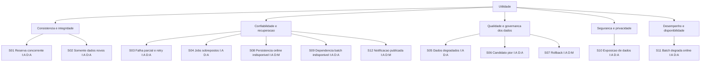

# Avaliação Arquitetural - Ciclo 01 (ATAM)

## Escopo e método

Esta é uma avaliação documental inicial baseada nas fontes do repositório, seguindo os passos ATAM de explicitar direcionadores, priorizar atributos de qualidade, elaborar cenários, analisar abordagens/sensibilidades/trade-offs e registrar riscos. Não houve workshop com stakeholders reais nem validação das prioridades. As prioridades I/D são as classificações qualitativas preliminares de `docs/arquitetura.md` (I: importância; D: dificuldade; A/M/B: alta/média/baixa), não decisões aprovadas.

Fontes principais: [arquitetura](../arquitetura.md), [requisitos funcionais](../../PRD/requisitos-funcionais.md), [requisitos não funcionais](../../PRD/requisitos-nao-funcionais.md), as quatro personas e o código/testes existentes. A arquitetura contém oito ADRs, todos marcados **propostos, não aprovados**. Não foram localizados ADRs em arquivos separados. As metas RNF são iniciais e estão sujeitas a validação.

Consulta de CI: `gh run list -R Kaique662/qualidade_software --limit 20` retornou `[]`; portanto, não há runs de Actions disponíveis para avaliar. Não foi encontrado arquivo em `.github/`. A listagem sem `-R` não funcionou porque o repositório padrão do `gh` não está configurado.

## Direcionadores de negócio

| ID | Direcionador documentado | Origem e ressalva |
| --- | --- | --- |
| D1 | Alocar salas, professores e materiais sem conflitos de horário. | Objetivo do PRD; `RF-COORD-009` a `012`, `RF-REC-014` a `016`. |
| D2 | Planejar, revisar, aprovar e publicar grades preservando rascunhos, versões e histórico. | `RF-COORD-014` a `020`, `RF-PROF-007` a `016`. |
| D3 | Manter inventário, disponibilidade, manutenção, bloqueios e ocorrências dos recursos. | `RF-REC-001` a `020`. |
| D4 | Permitir consulta e auditoria rastreáveis, protegendo dados e restringindo operações por papel. | `RF-PROF-020`, `RF-AUD-001` a `020`, `RNF-GER-001` a `010`. |
| D5 | Atender atributos de qualidade propostos: concorrência, integridade, desempenho, disponibilidade, recuperação, acessibilidade e compatibilidade. | RNFs; os critérios numéricos não são compromissos aceitos. Há tensão entre consulta p95 ≤ 2 s (`RNF-GER-011`) e abertura de grade p95 ≤ 3 s (`RNF-COORD-001`). |
| D6 | Executar job diário ao final do dia usando somente dados novos. | `C-ARQ-001`, registrado na arquitetura como restrição fornecida na solicitação que a originou, não localizada no PRD. Não presumir que seja requisito aprovado do produto. |

## Utility tree

As folhas e prioridades reproduzem a análise preliminar da arquitetura (§19.2–19.3). Todas têm importância alta; dificuldade alta prioriza validação antecipada, não representa esforço estimado. Qualidade de ML/serving permanece condicional: `RF-COORD-015` pede proposta automática, mas não exige ML.

## Cenários de atributo de qualidade

Cada cenário explicita as seis partes ATAM: fonte, estímulo, artefato, ambiente, resposta e medida de resposta. As métricas numéricas originadas em RNFs continuam propostas.

| Cenário | Fonte | Estímulo | Artefato | Ambiente | Resposta esperada | Medida de resposta |
| --- | --- | --- | --- | --- | --- | --- |
| **S01 - Reserva concorrente** (`I:A, D:A`) | Coordenadora/usuários concorrentes; `RF-COORD-009` a `012`, `RNF-GER-013`/`014`, `RNF-REC-003`. | Duas ou mais solicitações tentam alocar o mesmo recurso e intervalo de forma incompatível. | Validador, controle de concorrência, persistência e auditoria. | Online sob concorrência; RNF propõe 100 tentativas simultâneas, sujeito a aceite. | No máximo uma incompatível confirmada; demais recebem conflito; sem gravação parcial. | Contagem de confirmações/conflitos e estado persistido; critérios RNF ainda propostos. |
| **S02 - Somente dados novos** (`I:A, D:A`) | Restrição `C-ARQ-001`; responsável pela origem não identificado. | Chega o tick diário com registros posteriores ao checkpoint confirmado. | Scheduler, leitor incremental, checkpoint, manifesto e treinador. | Execução batch normal; fuso e corte diário indefinidos. | Treino recebe somente dados elegíveis posteriores ao checkpoint; não inclui histórico anterior. | IDs/cursor do manifesto comparados ao checkpoint; critério sem contrato de fonte não é finalizável. |
| **S03 - Falha parcial** (`I:A, D:A`) | Operação batch; `C-ARQ-001`, `RNF-GER-014`, `RNF-GER-007` a `009`. | Falha após persistir uma etapa, inclusive candidato criado e checkpoint ainda não atualizado. | Estado do run, manifesto, candidato, lock e checkpoint. | Falha/reinício durante ingestão, treino, registry ou checkpoint. | Reconciliar a mesma execução sem duplicar efeito; não avançar checkpoint sem resultado durável; preservar versão ativa. | Consistência entre run, manifesto, artefato e cursor; retries/tempo de recuperação não definidos. |
| **S04 - Jobs sobrepostos** (`I:A, D:A`) | Scheduler/operador; `C-ARQ-001`. | Dois disparos/workers iniciam o mesmo lote por atraso, retry ou duplicidade. | Coordenador, lock/lease, fencing, execução e checkpoint. | Uma ou mais instâncias; topologia desconhecida. | Um proprietário válido altera o estado; worker sem lease não faz commit tardio. | Histórico de titularidade e checkpoint sem commits concorrentes; limites de espera/retry não definidos. |
| **S05 - Dados degradados** (`I:A, D:A`) | Origem/owner de dados, ainda não identificados; `C-ARQ-001`, `RNF-GER-005`. | Lote traz schema inesperado, duplicidade, atraso ou qualidade insuficiente. | Leitor, validador, deduplicação, manifesto e conjunto de treino. | Batch com dados parcialmente válidos; regras de elegibilidade pendentes. | Classificar e rastrear entradas; não treinar dados inválidos nem descartá-los silenciosamente. | Contagens por classe e prova de entradas entregues ao treino; limites de qualidade/atraso não definidos. |
| **S06 - Candidato pior/inconclusivo** (`I:A, D:A`) | Avaliador/model owner e negócio, ainda não identificados; `RNF-AUD-004`, `008`, `009`; nenhum RF define qualidade do modelo. | Candidato não satisfaz um gate aprovado ou avaliação não é conclusiva. | Avaliador, registry, referência ativa e relatório de linhagem. | Modelo ativo anterior ou serving desabilitado. | Registrar métricas/decisão; não substituir modelo ativo por candidato pior; sem modelo anterior, ML permanece desabilitado. | Gate, baseline, tolerância e volume mínimo ainda não existem; verificar status e referência ativa sem inventar limiar. |
| **S07 - Rollback** (`I:A, D:M`) | Operador/model owner não identificado; `RNF-GER-007`, `RNF-AUD-004`; abordagem proposta. | Versão promovida apresenta degradação confirmada. | Registry, referência ativa, serving e auditoria. | Serving habilitado e versão anterior aprovada disponível; cenário condicional. | Restaurar versão anterior sem retreinar nem alterar alocações; registrar ação. | Versão ativa e trilha de auditoria; prazo de rollback não definido. |
| **S08 - Persistência online indisponível** (`I:A, D:M`) | Falha de infraestrutura; `RF-COORD-009`, `RNF-GER-014`, `RNF-COORD-004`. | Aplicação não consegue ler/gravar estado durante alocação. | Aplicação online, validador e persistência. | Fluxo de planejamento com armazenamento indisponível/timeout. | Não declarar sucesso nem criar estado parcial; informar falha recuperável e preservar última versão confirmada. | Zero sucesso sem persistência e nenhuma alteração parcial; tempo de recuperação do caso não definido. |
| **S09 - Dependência batch indisponível** (`I:A, D:A`) | Dependência operacional; `C-ARQ-001`, `RNF-GER-016`, `RNF-GER-020`. | Origem, checkpoint ou registry falha no tick diário. | Coordenador, origem, checkpoint, registry e alerta. | Job iniciado; indisponibilidade transitória ou persistente. | Registrar etapa/causa sem dados sensíveis; não avançar checkpoint sem resultado durável; manter serving ativo; parar se checkpoint for incerto. | Estado/watermark não avançam sem confirmação; retries/alerta mensuráveis, limites pendentes. |
| **S10 - Exposição de dados** (`I:A, D:A`) | Usuário sem privilégio, operador ou saída/log; `RF-PROF-020`, `RNF-GER-003` a `006`, `RNF-AUD-003`/`010`. | Tentativa de acesso/inspeção revela disponibilidade, credencial ou dado pessoal desnecessário. | Autorização, exportações, logs, storage temporário, checkpoints e ML. | Online e batch com dados conforme autorização. | Negar acesso, minimizar/mascarar, não registrar segredo; auditar tentativa sem replicar payload. | Testes negativos e varredura sem exposição; classificação/dataset de teste pendentes. |
| **S11 - Batch degrada online** (`I:A, D:A`) | Coordenador/professor; `RNF-GER-011`/`012`/`015`, `RNF-COORD-001`, `RNF-PROF-002`. | Treino/serving coincide com consultas, validações e gravações. | Scheduler, worker, aplicação online, persistência e serving opcional. | Perfil RNF inicial não aprovado; infraestrutura compartilhada ou isolada desconhecida. | Regras online continuam autoritativas; falha de ML não impede fluxo manual; persistência indisponível não confirma gravação. | p50/p95/p99 e erros comparados com RNFs; metas pendentes e p95 de grade versus consulta divergem. |
| **S12 - Notificação de publicação** (`I:A, D:M`) | Coordenador publica alteração; `RF-PROF-014`/`015`, `RF-REC-019`, `RF-AUD-015`. | Publicação confirmada afeta atividade de professor/recurso. | Aplicação, despacho, estado de entrega e auditoria. | Canal interno ou provedor externo parcialmente indisponível; canal não escolhido. | Enviar após confirmação, informar valores anterior/novo/vigência e destinatários autorizados; rastrear falha sem duplicidade indevida. | `RNF-PROF-004` propõe 99% em até 60 s no canal interno; meta pendente; medir latência/duplicidade/entrega. |

## Abordagens e táticas: evidência no código

Os cenários de maior prioridade são S01–S06, S09–S11 (`I:A, D:A`). Para esses cenários, **não foi encontrada tática implementada no domínio-alvo**. A arquitetura descreve validador transacional, checkpoint, manifestos, idempotência, fencing, quarentena, gates, observabilidade e isolamento como propostas; não são evidências de implementação. Os oito ADRs (§22 da arquitetura) também são propostos, não aprovados.

| Cenário de alta prioridade | Tática/abordagem efetivamente encontrada | Evidência e alcance |
| --- | --- | --- |
| S01 - concorrência de alocação | Nenhuma reserva, validação temporal ou controle de concorrência para sala/material/professor. Há somente verificação prévia de unicidade de e-mail/matrícula no cadastro de estudante. | [StudentApiController.java](../../src/main/java/com/example/educationalqualityproject/controller/api/StudentApiController.java#L46-L58). Não prova atomicidade/concurrency control e não atende alocação. |
| S02 - incremental diário | Nenhuma rotina batch, scheduler, cursor ou checkpoint encontrada em `src/main/java`. | Inventário de arquivos Java consultado; README descreve somente cadastro de estudantes e professores ([README.md](../../README.md#L3-L20)). |
| S03/S04 - falha parcial e sobreposição | Nenhuma execução idempotente, run ID, lock/lease/fencing ou reconciliação de checkpoint no código. | Os serviços de estudante/professor delegam CRUD aos repositórios ([StudentService.java](../../src/main/java/com/example/educationalqualityproject/service/StudentService.java#L17-L38), [TeacherService.java](../../src/main/java/com/example/educationalqualityproject/service/TeacherService.java#L17-L35)). |
| S05/S06/S09 - qualidade de dados, modelo e dependências batch | Nenhum pipeline de dados, treino, avaliação, registry, gate ou rollback encontrado. | O código listado em `src/main/java` contém entidades/controller/services de cadastro e a página inicial; a aplicação retorna a view `home` ([HomeController.java](../../src/main/java/com/example/educationalqualityproject/controller/HomeController.java#L6-L12)). |
| S10 - proteção/privacidade | Nos controllers de API de estudante/professor há CORS `origins = "*"`; não há nesses controllers evidência de autorização por papel. Não se conclui daí a configuração de segurança global. | [StudentApiController.java](../../src/main/java/com/example/educationalqualityproject/controller/api/StudentApiController.java#L13-L19) e `TeacherApiController.java` (`/api/teachers`, mesmo padrão). A abordagem não cobre os artefatos sensíveis projetados no cenário. |
| S11 - contenção de desempenho online/batch | Nenhuma separação, limite de worker ou instrumentação de carga encontrada. Os testes existentes cobrem contexto e página inicial, não latência/carga. | [HomeControllerTest.java](../../src/test/java/com/example/educationalqualityproject/controller/HomeControllerTest.java#L19-L24) e [EducationalQualityProjectApplicationTests.java](../../src/test/java/com/example/educationalqualityproject/EducationalQualityProjectApplicationTests.java#L9-L11). |

As únicas abordagens observáveis são de outro escopo: controllers REST de estudantes/professores, CRUD em serviços/repositórios e respostas HTTP (por exemplo, conflito de cadastro e `201 Created` em estudante, [StudentApiController.java](../../src/main/java/com/example/educationalqualityproject/controller/api/StudentApiController.java#L46-L58)). Não são táticas para os cenários de qualidade do sistema de alocação.

## Sensibilidades e trade-offs

| Sensibilidade | Driver/cenários | Trade-off documentado |
| --- | --- | --- |
| Semântica de cursor/checkpoint (offset, watermark ou manifesto) | D2; S02/S03/S05/S09. | Cursor simples versus tolerância a atraso/correção; replay e duplicidade dependem do contrato da origem. |
| Fronteira de commit entre artefato, avaliação e checkpoint | D2/D5; S03/S06/S07/S09. | Avançar cedo pode perder dados; avançar tarde pode repetir efeitos. Não há atomicidade definida entre stores. |
| Exclusão mútua e fencing | D2/D5; S03/S04. | Lock local é simples apenas com singleton garantido; lease distribuído/fencing aumenta complexidade. |
| Isolamento de batch dos recursos online | D1/D5; S08/S09/S11. | Compartilhar reduz infraestrutura, mas arrisca contenção; separar eleva custo/operação. |
| ML no caminho online | D1/D2/D5; S06/S07/S09/S11. | Sugestão opcional ou serviço síncrono; ML não é exigido por `RF-COORD-015`. |
| Gate e promoção | D2/D4; S06/S07. | Aprovação manual dá controle mas pode atrasar; automática requer métrica/baseline/autoridade ausentes. |
| Linhagem versus retenção/minimização | D4/D5; S03/S05/S10. | Snapshot completo facilita reprodução, aumenta exposição/custo; manifesto reduz dados, mas pode limitar replay. |
| Auditoria síncrona versus outbox | D4/D5; S01/S03/S08/S10. | Escrita síncrona pode elevar latência/acoplamento; outbox traz eventualidade e consumidor/retry. |

## Riscos, não riscos e temas de risco

### Riscos

| ID | Risco e cenário | Direcionador relacionado |
| --- | --- | --- |
| AR-ATAM-01 | Cursor/origem sem contrato pode repetir ou omitir dados; S02/S03/S05/S09. | D2 |
| AR-ATAM-02 | Falha entre registry e checkpoint pode duplicar candidato ou divergir estado; S03/S06/S09. | D2/D5 |
| AR-ATAM-03 | Jobs/worker zumbi concorrentes podem confirmar o mesmo lote; S03/S04. | D2/D5 |
| AR-ATAM-04 | Dados novos insuficientes/degradados podem propagar erro ou viés; S05/S06. | D2/D4 |
| AR-ATAM-05 | Sem gate aprovado pode promover candidato inferior ou bloquear um útil; S06/S07. | D1/D2 |
| AR-ATAM-06 | Rollback pode falhar se a versão anterior/ponteiro controlado não existir; S07/S09. | D2/D5 |
| AR-ATAM-07 | Fonte/persistência/registry indisponível pode perder progresso ou atrasar alerta; S03/S08/S09. | D2/D5 |
| AR-ATAM-08 | Dados pessoais podem vazar em logs, manifestos, exportações, temporários ou modelo; S05/S10. | D4 |
| AR-ATAM-09 | Batch/serving compartilhado pode degradar ou indisponibilizar o online; S08/S11. | D1/D5 |
| AR-ATAM-10 | Metas de carga conflitantes/não aprovadas impedem conclusão objetiva; S01/S11. | D5 |

Esses riscos são os registrados na análise ATAM da arquitetura, ainda abertos e sem aceitação/owner documentado. O código atual não constitui evidência de mitigação para eles.

### Não riscos segundo a evidência disponível

- ML no fluxo online não é requisito confirmado; `RF-COORD-015` não especifica modelo.
- Promoção automática de modelo ou publicação automática de grade não é exigida; `RF-COORD-020` requer versão aprovada.
- Valores RNF são metas iniciais, não SLAs aprovados.
- A stack do README descreve a aplicação atual, mas não aprova essa stack para a arquitetura-alvo.
- Usar dados históricos para cumprir `C-ARQ-001` não tem fundamento na restrição literal. Isso não decide a política para lote vazio/replay.

Esses pontos só permanecem não riscos enquanto não forem assumidos como requisitos por uma implementação sem decisão registrada.

### Temas de risco

1. Semântica de novidade, qualidade, atraso e progresso incremental dos dados (D2; S02–S05/S09).
2. Consistência de execução distribuída, commits, lock e reconciliação (D2/D5; S03/S04/S09).
3. Governança, utilidade, validação e promoção de ML opcional (D1/D2; S05–S07).
4. Privacidade durante coleta, treinamento, auditoria, exportação e descarte (D4; S10).
5. Contenção de falhas, desempenho e custo entre batch e operação online (D1/D5; S08/S09/S11).
6. Critérios de aceitação RNF, perfil de carga e prioridade de latência (D5; S01/S11).

## Divergências entre arquitetura e código

| A arquitetura descreve/propoõe | O código observado | Divergência |
| --- | --- | --- |
| Alocação de salas/professores/materiais e validação de conflito (`RF-COORD-009` a `012`; arquitetura §3/§17.1). | Não foram encontrados controller, serviço ou entidade de alocação; API existente é cadastro de estudante/professor ([StudentApiController.java](../../src/main/java/com/example/educationalqualityproject/controller/api/StudentApiController.java#L13-L19)). | O domínio arquitetural não está implementado. |
| Consistência sob concorrência, integridade transacional e controle de versão. | Serviços CRUD chamam `findAll`, `findById`, `save` e `deleteById`; não há fluxo de reserva/transação no código desses serviços ([StudentService.java](../../src/main/java/com/example/educationalqualityproject/service/StudentService.java#L17-L31)). | Táticas online de S01/S08 não foram encontradas. |
| Rascunho, aprovação, publicação, histórico e notificação. | Não foram encontrados componentes de grade, workflow de aprovação ou despacho; home só retorna `home` ([HomeController.java](../../src/main/java/com/example/educationalqualityproject/controller/HomeController.java#L9-L12)). | Capacidades de D2/S12 não estão implementadas. |
| Job diário, somente dados novos, checkpoint, manifesto, treino/registry e recuperação (§14–15/§17.2). | Nenhum código batch/ML/scheduler foi encontrado em `src/main/java`. | D6 e cenários S02–S07/S09 existem apenas na arquitetura como restrição/propostas. |
| Auditoria, controle por papel, proteção e métricas (`RF-AUD-*`, `RNF-*`). | Testes limitam-se ao carregamento de contexto e à página inicial; não validam domínio, perfis, carga ou auditoria ([HomeControllerTest.java](../../src/test/java/com/example/educationalqualityproject/controller/HomeControllerTest.java#L19-L24), [EducationalQualityProjectApplicationTests.java](../../src/test/java/com/example/educationalqualityproject/EducationalQualityProjectApplicationTests.java#L9-L11)). | Não há evidência de implementação/teste para D4/D5. |
| Produto futuro de alocação como escopo da arquitetura. | README declara Java/Spring/MongoDB e CRUD de alunos/professores ([README.md](../../README.md#L3-L20)). | Escopo atual e produto arquitetural diferem; relação/evolução não está decidida. |
| CI e evidências de execução. | Não há `.github/workflows`; consulta explícita ao Actions retornou nenhum run. | Não há evidência de check CI ou de qualidade dos cenários no Actions. |

As divergências são de cobertura/escopo constatado, não prova de impossibilidade técnica. A arquitetura declara em seu cabeçalho que é proposta sujeita à validação e que não registra decisões de tecnologia; portanto, não se classificam essas propostas como funcionalidades prometidas por um release aprovado.

## Ações priorizadas para o próximo ciclo

| Prioridade | Ação | Motivo / saída esperada |
| --- | --- | --- |
| **P0** | Confirmar com product owner se o alvo é evoluir o CRUD atual ou criar o sistema de alocação como produto separado. | Resolver a divergência de escopo antes de selecionar topologia ou criar componentes. |
| **P0** | Validar com coordenação e gestão de recursos os limites temporais, buffers, capacidade/quantidade, conflitos, estados de recurso e exceções. | Converter S01 em critérios completos sem inferir endpoint, tolerância ou exceção. |
| **P0** | Identificar owner da fonte batch e definir schema, identidade/cursor, atraso, correção, “dado novo”, timezone do tick, lote vazio/inválido e replay. | Tornar S02–S05/S09 avaliáveis; até lá não aprovar ADR-02/03. |
| **P0** | Definir classificação/base de uso, acesso, retenção e responsabilidades de privacidade para dados e artefatos. | Reduzir incerteza de D4/S10 antes de coletar ou treinar dados reais. |
| **P1** | Definir modelo de concorrência/transação, fronteira de commit, comportamento offline e autoridade de validação online; validar S01/S03/S08. | Estabelecer critérios de falha/recuperação e comparar com `RNF-GER-013`/`014`. |
| **P1** | Decidir se ML é adotado; se sim, aprovar tarefa, métricas, baseline, volume mínimo, gate, responsável e rollback. | Manter ML opcional até haver critério para S06/S07; `RF-COORD-015` sozinho não escolhe ML. |
| **P1** | Aprovar perfil de carga, ambiente, disponibilidade, RPO/RTO e resolver a latência de consulta versus abertura da grade. | Tornar S08/S11 e os RNFs mensuráveis e não contraditórios. |
| **P1** | Definir o contrato de auditoria/notificação em sucesso parcial, falha, retry e duplicidade; nomear responsáveis. | Avaliar D4 e S12; ADR-05/08 seguem propostas. |
| **P2** | Executar experimentos S01/S02/S03/S05/S10 com dados sintéticos/autorizados e injeção de falhas após os contratos serem aprovados. | Produzir evidência arquitetural; os experimentos listados em `docs/arquitetura.md` ainda são propostas, não execuções. |
| **P2** | Realizar walkthrough ATAM com stakeholders reais e reclassificar I/D; registrar decisões, owners e critérios aceitos. | Substituir a priorização analítica preliminar por prioridades negociadas. |

Nenhum código, requisito ou ADR foi alterado nesta avaliação. As prioridades e táticas propostas permanecem recomendações até revisão dos responsáveis do produto.